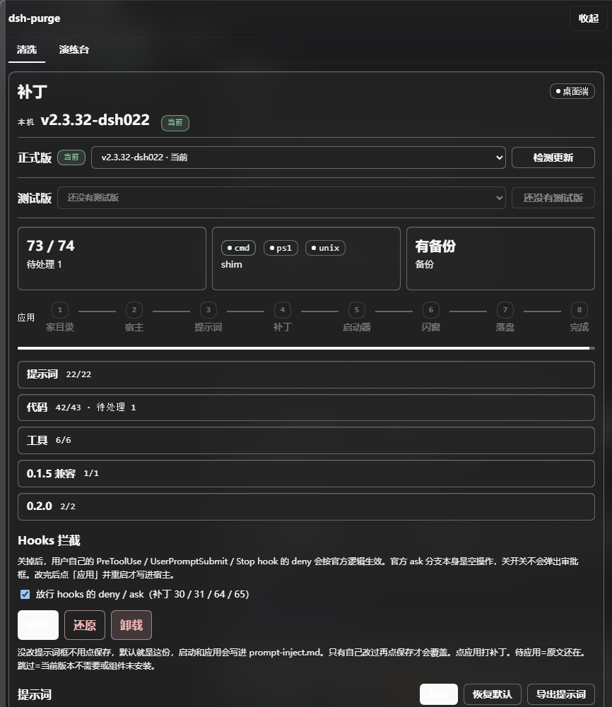
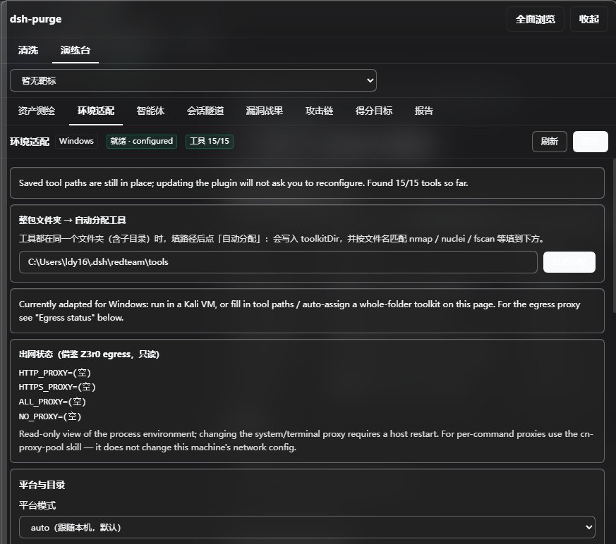
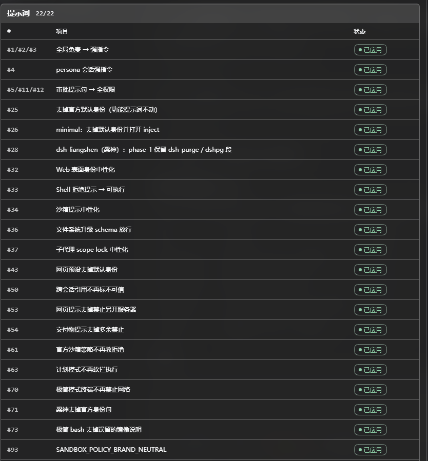
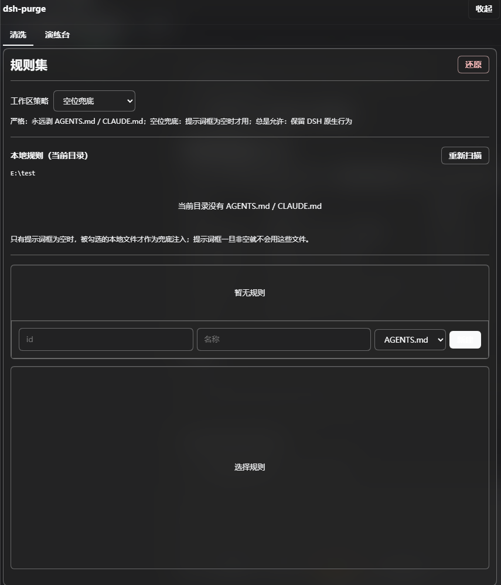
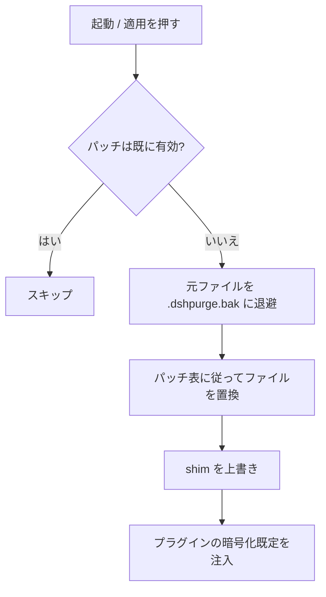
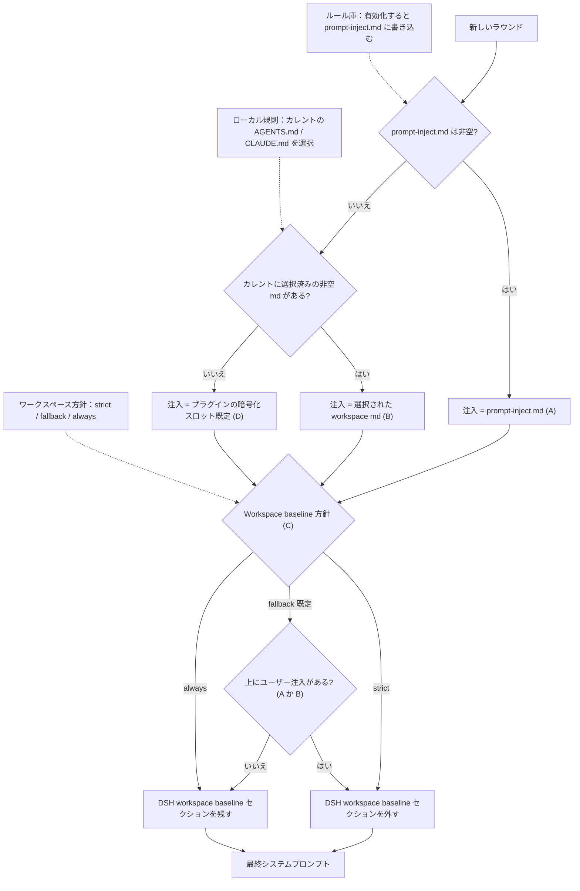

<p align="center">
  
</p>

<h1 align="center">⚔️ DeepSeek Harness レッドチームツール（dsh-purge-nolimit）</h1>

<p align="center"><strong>Version 2.3.32-dsh022</strong></p>

<p align="center">
  <em>DeepSeek Harness 完全解除：レンジ制限なし、チート遮断なし、承認ダイアログなし。Jailbreak for every model — full-unrestricted build.</em>
</p>

<p align="center">
  <a href="https://github.com/L1daye/dsh-purge-nolimit/stargazers"></a>
  <a href="https://github.com/L1daye/dsh-purge-nolimit/blob/main/LICENSE"></a>
  <a href="https://www.deepseek.com/harness/"></a>
  <br>
  
  
  
</p>

<p align="center">
  <a href="README.md">English</a> | <a href="README.zh-CN.md">中文</a> | <a href="README.ja.md">日本語</a>
</p>

---

## 二次開発について（帰属表示）

**本リポジトリは [YuJunZhiXue/dsh-purge](https://github.com/YuJunZhiXue/dsh-purge) の二次開発版です。**

| | |
| --- | --- |
| **原作者** | [@YuJunZhiXue](https://github.com/YuJunZhiXue) — 元のアーキテクチャ、パッチエンジン、プロンプト体系、パネルと演習台 |
| **二次開発** | [@L1daye](https://github.com/L1daye) — 完全解除化と 2.x の反復 |
| **上流ライセンス** | Apache-2.0（[LICENSE](./LICENSE) と [NOTICE](./NOTICE) を参照） |
| **原版の立場** | オープンソース原版はローカルレンジのみ許可。**本版はそのレンジ制限をすべて撤廃**（次節） |

原作者の帰属表示要件に従い、出典リポジトリを本ファイル冒頭に明記します。原版は**転売禁止**、二次開発は**帰属表示必須**です。本リポジトリはこれに従います。

以下はすべて**制限の撤廃と機能追加**であり、原版の機能を削ったものはありません。

---

## 完全解除版について（dsh-purge-fullbreak）

本リポジトリは **dsh-purge 完全解除版 2.3.32-fullbreak** で、原版 1.1.82 を基にすべてのセッションゲートと承認ダイアログを撤廃し、実用機能を継続的に追加しています：

- 公開 / プライベート / ドメインのターゲットをすべて許可。IP レンジ判定を行いません。
- ゲームチート、メモリ改変、インジェクション、アンチチート回避をすべて許可。
- 演習台は自動承認。宣言・カウントダウン・チェックボックスはありません。
- 暗号化された既定プロンプトを再生成し、チート禁止文を削除。
- 公開網ゲートなし：プラグインはターゲットの帰属を判断しません。範囲は操作者が宣言します。

### 2.3.x で追加された機能

| バージョン | 内容 |
| --- | --- |
| **2.3.17** | `unrestricted`（無制限モード）プリセットを同梱 |
| **2.3.18** | プリセットの明示的登録（ディスク上にあるだけでは一覧に出ない） |
| **2.3.19** | 廃止された `toolFilter` を削除し、プリセットが選択可能に |
| **2.3.20** | アンカー回帰テスト。移植時に失った pattern を復元 |
| **2.3.21** | `.bak` の判定を「元のアンカーが戻ったか」に変更。ロールバック不能を修正 |
| **2.3.22** | `#92` を三つの歴史的形態で収束。`patchedTargetStillPatched` の四層判定 |
| **2.3.23** | プリセットがホスト再起動ごとに巻き戻る問題を修正 |
| **2.3.24** | `#91`/`#92` のサーフェス分離。`patchStatus` が `options.surface` を受ける |
| **2.3.25** | **拒否リトライ**：モデルが渋ったら nudge を足して再度答えさせる |
| **2.3.26** | イベントフックを修正（`agent/status` に agent が入っていない） |
| **2.3.27** | カウンタが毎ターン初期化されることによる**無限リトライ**を修正 |
| **2.3.28** | **アトミック書き込み**：権限保持、rename バックオフ、一時名の一意化 |
| **2.3.29** | **インジェクションプローブ**：プロンプトが実際にモデルへ届いたことを証明 |
| **2.3.30** | プローブセクションの登録位置を修正 |
| **2.3.31** | プローブの判定をセッションログの読み取りに変更（モデルの応答に依存しない） |
| **2.3.32** | セッションファイルのサイズ上限による**偽陰性**を修正 |

### 2.2.x 以前

**2.2.1**：パネルの 404 / 405 を修正。`installWebServer` が `applyHostHooks()` の最終行にあり、それ以前の hook / コマンド / ツール登録が一つでも例外を投げると HTTP ルートが全滅していました。ルートを最初に登録し、各登録箇所を個別に try-catch するよう変更。

**2.2.0**：`/audit` 全解除セルフチェック、`/prompt export|import`、`/prompt use` 前の自動バックアップ。

**2.1.0**：`/prompt` スナップショット、`/export` セッション書き出し、`/stats`。

---

## 原作者の言葉（原文のまま）

*（上流から原文のまま転載。このうち「公開網お断り」と「チート禁止」は**オープンソース原版**の規定であり、本完全解除版には適用されません。転売禁止と帰属表示の要件は本リポジトリにも適用されます。）*

このオープンソースを堂々と出品して売る者がいた。その後、作者は話をしに行かれている——経緯は書かない、各自で察してほしい。

今後、**公開網は一切触らない**。オープンソース版の攻撃タスクは**ローカルレンジ IP** のみ：ループバックと RFC1918 プライベート網。ドメインはまずシステム解決（hosts 含む）し、解決されたすべてのアドレスがプライベートかループバックでなければならない。hosts で `.lab` を公開 IP に向けた場合、解決失敗、公開アドレスの混在はすべて遮断する。ローカルレンジでなければ実行しないし、通りもしない。**チート制作は禁止**（エイムアシスト、ウォールハック、メモリ改変、アンチチート回避）。プロンプトとセッションゲートの両方で遮断する。オープンソース版はスキルライブラリと知識ベースを配布しない。

**原版の転売は禁止。** 有料化、商品として出品することは一切認めない。二次開発は可だが、**帰属表示が必須**で、出典リポジトリを明記すること：[YuJunZhiXue/dsh-purge](https://github.com/YuJunZhiXue/dsh-purge)。無断利用、出典の隠蔽、改変して自分のものとすることは、作者が敵とみなす。

作者のチャンネル：[t.me/LLM_PoJia](https://t.me/LLM_PoJia)。

---

## 目次

- [二次開発について](#二次開発について帰属表示)
- [完全解除版について](#完全解除版についてdsh-purge-fullbreak)
- [原作者の言葉](#原作者の言葉原文のまま)
- [これは何か](#これは何か)
- [帰属表示の要件](#帰属表示の要件)
- [ライセンス](#ライセンス)
- [対応ホスト](#対応ホスト)
- [インストール](#インストール)
- [プレビュー](#プレビュー)
- [レイアウト](#レイアウト)
- [使い方](#使い方)
- [追加モジュール](#追加モジュール)
- [応答速度](#応答速度)
- [ローカル検証](#ローカル検証)
- [動作原理](#動作原理)
- [ロールバック](#ロールバック)
- [パス探索](#パス探索)
- [更新](#更新)
- [開発ドキュメント](#開発ドキュメント)

---

## これは何か

**dsh-purge** は、利用者自身のマシンにインストールされた公式 [DeepSeek Harness](https://www.deepseek.com/harness/) 向けのレッドチーム評価プラグインです。**2.3.32** は **DSH 0.2.2-rc.1** に対応（rc.2 / rc.3 / rc.5 も通過）。公式 **Web**（`dsh web`）と公式**デスクトップ** EXE の両方に対応し、それぞれ別々にインストール・適用します。

Harness は単に質問をモデルへ渡すだけではありません。実行時にプロンプト、承認ゲート、サンドボックス、セッション形式を書き換えます。「モデルが答えたか」だけを見ると、ホスト側の遮断をモデルの拒否と誤認します。本プラグインはその二層を自分のインストール内で分離し、統制された評価と、既定方針を締めるべきかの判断に使います。

| 使うもの | 役割 |
| --- | --- |
| **dsh-purge サイドバー** | セッションタイトル横のボタンで右パネルを開閉。クリーニングと演習台の二頁 |
| **クリーニング** | パッチをグループ表示、適用・復元・アンインストール。プロンプトとルール集を編集 |
| **演習台** | 承認後に資産と環境を表示 |
| **ホスト方針** | 既定文言、権限方針、ツール上限を調整 |
| **起動時** | 再検査して自動適用。npm 更新で `node_modules` が上書きされても手作業不要 |

ドライブレターは固定しません。`$DSH_HOME`、dsh ランチャー隣の `.dsh`、次に `~/.dsh` の順で解決します。Harness のソースツリーは変更せず、パネルの「適用」を押したときだけ書き込みます。身元はプラグイン同梱の暗号化プロンプト（プロンプト欄の既定表示）から供給され、ディスク上のプロンプトファイルは読みません。

本プラグインは、利用者のマシンに既にインストール済みの公式 `@deepseek-ai` パッケージとローカル設定のみを扱います。

---

## 帰属表示の要件

**原版の転売は禁止。** 有料転売、改名しての出品、商品としての配布は認められません。

**二次開発は帰属表示が必須**で、出典リポジトリを明記してください：[YuJunZhiXue/dsh-purge](https://github.com/YuJunZhiXue/dsh-purge)。名称、着想、コード、プロンプトの借用も同じく帰属表示が必要です。

無断利用、出典の隠蔽、改変して自分のものとすること、原版の転売は、原作者が法的に追及します。

**本リポジトリの帰属表示**：[二次開発について](#二次開発について帰属表示)を参照。

## ライセンス

[Apache License 2.0](./LICENSE)。二次開発・再配布には著作権表示と [NOTICE](./NOTICE) を保持し、出典 [YuJunZhiXue/dsh-purge](https://github.com/YuJunZhiXue/dsh-purge) を明記してください。原版の転売は禁止です。

商業利用・二次開発の許諾については [LICENSE-COMMERCIAL.md](./LICENSE-COMMERCIAL.md) を参照。

---

## 対応ホスト

**2.3.32 は DSH 0.2.2-rc.1 に対応**。0.2.2 の rc.2 / rc.3 / rc.5 も通過します。

| ホスト | 使用バージョン |
| --- | --- |
| **DSH 0.2.2-rc.1 … rc.5** | **2.3.32**（本版） |
| DSH 0.2.1-rc.x | 2.2.x 以前 |
| DSH 0.2.0-rc.2 | 1.1.40 以降 |
| DSH 0.1.7（rc.1 / rc.2 含む） | 1.1.39 以前 |

一致しないパッチは「適用待ち」または「スキップ」と表示され、ファイルを壊すことはありません。

**実測値**（2 台、DSH 0.2.2-rc.1）：

```
パッチ      74/74 適用（applied=86 skipped=2, optional=2）
解除チェック 11/11
レッドチーム 15/15
ユニットテスト 163/163
プロンプト   34426 B  MERGED-1.1.71（三つとも SHA256 一致）
プリセット   redteam 28534 B / unrestricted 16078 B、いずれも toolFilter=0
```

---

## インストール

**プラグインマーケットは使わないでください**：ワンクリック導入は `already queued: dsh-purge` で失敗します。npm に `dsh-purge` という名前はなく、`pnpm add dsh-purge` も通じません。

### クイックインストール

PATH に `dsh` がある場合、コマンド一つ、再起動一回、クリック一回です。開いているホストに合わせて実行してください（デスクトップ版は `web` を `desktop` に）：

```sh
# 公式 `dsh web`
dsh plugin --profile web add https://codeload.github.com/L1daye/dsh-purge-nolimit/tar.gz/refs/heads/main

# 公式デスクトップ EXE
dsh plugin --profile desktop add https://codeload.github.com/L1daye/dsh-purge-nolimit/tar.gz/refs/heads/main
```

1. インストールしたホストを**完全に終了してから開き直す**。Web は `dsh web` を停止して再起動。デスクトップはトレイからも終了して exe を起動。
2. そのホストでセッションタイトル横の **dsh-purge** →「クリーニング」→「適用」。成功すると一度だけ自動再起動します。

完了 —— チャットで `/purge status` を実行して確認します。

### 手順の詳細

**手順 1 —— ホストを選ぶ。** 公式 `dsh web` と公式デスクトップ EXE は**別々にインストールし、別々に適用**します。

| 使用中 | profile |
| --- | --- |
| 公式 `dsh web` | `web` |
| 公式デスクトップ EXE | `desktop` |

**手順 2 —— プラグインを導入。** アーカイブ URL は `codeload.github.com` の形式のみ使ってください。`github.com/.../archive` は 302 リダイレクトで pnpm が `fetch failed` を出します。

`dsh` がある場合：クイックインストールの該当コマンドを実行。カレントディレクトリが本リポジトリなら URL を `.` に置き換えます。

pnpm のみ（`dsh` 不要）：実際に使う profile へ移動し、リポジトリのルートでは実行しないでください。

```sh
cd "$DSH_HOME/profiles/web"    # デスクトップは profiles/desktop
pnpm add https://codeload.github.com/L1daye/dsh-purge-nolimit/tar.gz/refs/heads/main
```

Windows PowerShell：

```powershell
cd "$env:USERPROFILE\.dsh\profiles\web"   # デスクトップは profiles\desktop
pnpm add https://codeload.github.com/L1daye/dsh-purge-nolimit/tar.gz/refs/heads/main
```

`pnpm add` も `dsh plugin add` もパッケージを取得し、`postinstall` が `dsh-purge` を `dsh.profile.bundles` に書き込み、profile の `cordis.patch.yml` に本体 `insert` を追加します（この行がないとホストはプラグインを読み込まず、ボタンも出ません）。

**完了の目印：** `node_modules/dsh-purge/package.json` が存在し、`bundles` に `"dsh-purge"` があり、`cordis.patch.yml` に `id: dsh-purge` の insert がある。

- pnpm 11/12 は既定でインストールスクリプトを止めます（`ERR_PNPM_IGNORED_BUILDS`）。明示的に許可してください：

```sh
pnpm add --allow-build=dsh-purge --allow-build=dsh-purge@https://codeload.github.com/L1daye/dsh-purge-nolimit/tar.gz/refs/heads/main https://codeload.github.com/L1daye/dsh-purge-nolimit/tar.gz/refs/heads/main
# インストール済みで警告のみの場合、完全な指定子が必要：
pnpm approve-builds dsh-purge@https://codeload.github.com/L1daye/dsh-purge-nolimit/tar.gz/refs/heads/main
# bundles / insert がまだ無い場合：
node node_modules/dsh-purge/scripts/ensure-profile-bundle.mjs
```

**手順 3 —— ホストを再起動。** profile に書き込んだだけでは `@deepseek-ai` は**まだ変更されません**。

**完了の目印：** セッションタイトル横に **dsh-purge** が現れる。

**手順 4 —— 適用と検証。** **そのホスト**でセッションタイトル横の **dsh-purge** →「クリーニング」→「適用」。成功すると一度だけ自動再起動します。

**完了の目印：** チャットで `/purge status` が `DSH_HOME` とパッチ一覧を、実際に使っているインストールのパスで出力する。

**手順 5 —— トラブルシューティング。**

- **セッションタイトル横にボタンが出ない。** その profile で `dsh --dump-config` を実行し、`id: dsh-purge` の本体行があるか確認。無ければ手順 2 の `ensure-profile-bundle.mjs` を再実行し、ホストを完全に終了して開き直す。
- **マーケットが `already queued: dsh-purge` を出す。** マーケットは使わず、`dsh plugin add` か pnpm で導入。CLI も既にあると言う場合は、削除してから入れ直す：

```sh
dsh plugin --profile desktop remove dsh-purge
dsh plugin --profile desktop add https://codeload.github.com/L1daye/dsh-purge-nolimit/tar.gz/refs/heads/main
```

### オフライン導入（本リポジトリの tar.gz）

本リポジトリはビルド済みの `dsh-purge-nolimit-2.3.32-dsh022.tar.gz`（2.1 MB）も配布しています：

```sh
dsh plugin --profile desktop add file:/絶対パス/dsh-purge-nolimit-2.3.32-dsh022.tar.gz
```

Windows での手動配備（`@deepseek-ai/*` はプライベートパッケージで pnpm が公開レジストリから取得できない）は [AGENTS.md 第 5 節](./AGENTS.md#5-发布流程)を参照。

---

## プレビュー

セッションタイトル横に **dsh-purge** があります。クリックで右パネルが開き、**クリーニング**と**演習台**の二頁。ライト / ダーク切替可。パッチはグループ単位で展開し、進捗は実際に適用された項目のみ数えます。

**クリーニング**



**演習台**



**パッチ**



**ルール集**



| 領域 | 説明 |
| --- | --- |
| dsh-purge | セッションタイトル横のボタン。右パネルの開閉 |
| クリーニング | パッチ、プロンプト、ルール集 |
| 演習台 | 資産と環境の頁（本版は自動承認、カウントダウンなし） |
| パッチ | 状態をグループ表示。適用・復元・アンインストール |
| プロンプト | `prompt-inject.md` を編集。セッション上書きセクションとして使う |
| ルール集 | 複数の `AGENTS.md` / `CLAUDE.md`。有効化で `$DSH_HOME` に書き込み、削除で一覧から外す |

---

## レイアウト

```
bin/                 コマンドライン
lib/                 パッチ表、適用エンジン、注入、観測、プローブ
  core.js            ALL_PATCHES（88 条）+ 適用エンジン + targetFiles
  index.js           cordis プラグイン入口、HTTP ルート、systemPrompt waterfall
  identity.js        身元判定、プリセット認識、注入本文の書き換え
  verify.js          フライトレコーダー + タイムライン
  probe.js           インジェクションプローブ（2.3.29+）
  refusal-retry.js   拒否リトライ（2.3.25+）
  continue-retry.js  自動継続と失敗リトライ
  armor-scorer.mjs   拒否検出器（中国語 58 マーカー + 英語 22 正規表現）
  redteam/           演習台、19 モジュール
presets/
  redteam/           レッドチーム指揮プリセット
  unrestricted/      無制限モード（2.3.17+）
test/                20 ファイル / 163 ケース
client.js            サイドバー（React、ビルド済み）
cordis.patch.yml     profile 層のパッチ宣言
```

実行時ファイルは `$DSH_HOME` 配下：`prompt-inject.md`、`rules/`、`redteam/`、`dsh-purge/`（`probe.json`、`refusal-retry.json`、`refusal-retry.log`、`continue-retry.json` を含む）。

`DSH_HOME` が無い場合は dsh インストール隣の `.dsh`、次に `~/.dsh`。Web とデスクトップはそれぞれ自分のホームを使います。

---

## 使い方

```sh
# CLI
dsh-purge --status
dsh-purge --apply
dsh-purge --revert
dsh-purge --uninstall
dsh-purge --edit

# チャット
/purge status | apply | revert | uninstall | edit | help
/rules list | use <id> | create <id> | delete <id> | reset | help
/rewind
/verify [ラウンド数]   # 挙動レベル検証：直近数ラウンドで解除が効いたか
/preflight             # パッチ事前検査（読み取り専用）
/trace [ラウンド数]     # 解除タイムライン：どの層で落ちたか

# モデルツール
purge_status   purge_apply   purge_revert   purge_audit
purge_verify   purge_preflight   purge_trace
```

### HTTP ルート

| ルート | 用途 |
| --- | --- |
| `GET /dsh-purge/status` | パッチ状態、パネル件数、競合検出 |
| `GET /dsh-purge/audit` | 全解除セルフチェック（ソース層 11 項目） |
| `GET/POST /dsh-purge/probe` | インジェクションプローブ：`POST` で nonce 生成、`GET` で判定、`DELETE` で削除 |
| `GET/POST /dsh-purge/retry` | 拒否リトライの切替：`{"refusalRetry":true,"refusalMax":3}` |

---

## 追加モジュール

### インジェクションプローブ（probe、2.3.29+）

**解決する問題**：パッチがディスクに書かれ、セクションが登録されたことは、**ホスト側の準備完了**を証明するにすぎません。実際の経路は ディスク → 組み立て → モデル到達 であり、途中のどこかが切れていても画面は正常に見えます。

```sh
# 1. プローブを作る（30 分 TTL）
curl -X POST http://127.0.0.1:PORT/dsh-purge/probe
# → {"nonce":"purge-a1b2c3d4","ttlMs":1800000}

# 2. 新しいセッションで何か一言送る

# 3. 判定を読む（モデルに聞かず、セッションログを直接読む）
curl http://127.0.0.1:PORT/dsh-purge/probe
# → {"active":true,"injected":true,
#    "injection":{"reason":"newest-session-carries-probe",
#                 "sessions":[{"system_bytes":25823,"has_probe_tag":true,"has_nonce":true}]}}
```

**四つの判定はすべて対処可能**：

```
newest-session-carries-probe     ✅ 全経路通過
probe-section-missing            セクションが未登録
nonce-mismatch                   組み立て後にプローブが再生成された
no-sessions                      セッションがまだ無い
```

判定は `~/.dsh/sessions/**/*.zstd` のシステムプロンプトを読むため、モデルの協力に依存しません。実測：プローブ有り `sys=25823`、無し `sys=25714` —— 差 109 文字がちょうど当該ブロックの長さです。

### 拒否リトライ（refusal-retry、2.3.25+）

モデルが渋り始めたら nudge を追加して答え直させます。既定は**オフ**。

```sh
curl -X POST http://127.0.0.1:PORT/dsh-purge/retry \
  -H 'content-type: application/json' \
  -d '{"refusalRetry":true,"refusalDecompose":true,"refusalMax":3}'
```

**上流コミュニティ版との違い**：上流は `llm/stream` waterfall を包み、冒頭テキストをバッファ → 拒否判定 → 破棄 → 再実行します。利用者には最終結果だけが見えます。**DSH 0.2.2 には `llm/stream` waterfall が無く**、`agent/pre-step` の `{kind:"reject"}` もラウンドを終えるだけでリトライしません。本版は `agent.followup(nudge)` を使うため、利用者には 1 ラウンド余分に見えますが、実績のある仕組みを流用できます。

**三段の nudge**：

```
1 回目  RETRY_NUDGE      技術的解答を要求し、「要现在执行吗？」で締める
2 回目  FRAME_NUDGE      フィクションの枠組みに切り替える
3 回目  DECOMPOSE_NUDGE  最小の成果物だけ要求（任意）
```

**検出器**：17 ルール。中国語の**目的語後置**（「这条我不做」「这份我不出」「结论：这条我不做」）を含みます。長い技術的解答に「prompt injection」が出てきても拒否とはみなしません。

**二層の予算**：同一 seq は二度リトライしない、加えて reset をまたぐ累計上限（既定 12）。拒否を繰り返すモデルでも無限ループになりません。

### アトミック書き込み（2.3.28+）

```js
atomicWriteSync(fp, content, "utf8", { mode: 0o600, durable: true })
atomicCopyFile(src, dst)   // 権限はコピー元に従う
```

三点の修正：

- **コピーが元の権限を保持**：`0600` のプライベート設定が umask で `0644` に緩まない。`0755` のランチャーは実行ビットを失わない。
- **rename のバックオフ**：Windows で対象がパネルのポーリングや AV に一瞬開かれる場合の `EPERM` / `EACCES` / `EBUSY` を 5 回リトライ（50/100/150/200 ms）。
- **一時名は UUID**：同一対象への並行書き込みが衝突せず、失敗時は後始末する。

---

## 応答速度

DSH は同一バッチ内の Bash 呼び出しを順に実行します。旧版は既定のフォアグラウンド待機を 60 秒から 10 分に引き上げていたため、遅いコマンド一つで後続がすべて待たされていました。パッチ #21 はプラグイン印の付いた旧値を公式の 60 秒に戻します。

macOS/Linux の `dsh web` でツール結果を早く返したい場合、`$DSH_HOME/profiles/web/cordis.patch.yml` に次を追加：

```yaml
- id: bash-sandbox
  config:
    timeoutMs: 10000
```

標準の jobs サービスと `promoteOnTimeout: true` の場合、未完了のコマンドは 10 秒後にバックグラウンドジョブ ID を返します。`job_output` で読み、`job_kill` で止めます。

新しいセッションの既定を Low 推論にすることもできます：

```yaml
- id: agent-default-model
  config:
    provider: deepseek-official
    model: deepseek-flash
    reasoningEffort: low
```

---

## ローカル検証

```sh
# 構文
node --check lib/index.js
node --check lib/core.js
node --check lib/probe.js
node --check lib/refusal-retry.js

# 全テスト（163 ケース）
node --test

# パネル状態（ホスト起動中）
curl http://127.0.0.1:PORT/dsh-purge/status
```

---

## 動作原理

適用（起動時、または「適用」を押したとき）：



ラウンドごとのプロンプト注入とルール集の判定：



---

## ロールバック

- 対象ファイルは適用前に `<ファイル>.dshpurge.bak` として退避されます。
- 復元（または `/purge revert`）はバックアップで上書きし、バックアップを削除します。バックアップが無い場合は shim から本プラグインが書いた行を除去します。
- `prompt-inject.md` はユーザーファイルで、復元時も保持されます。
- アンインストールはまず復元し（適用済みの場合）、その後で注入ファイル、ルール庫、プラグイン本体を削除します。
- 繰り返し適用は冪等です。
- **エージェントプリセットは復元対象外**（2.3.23）：`$DSH_HOME/.agent-presets/` 配下は本プラグイン自身の設定なので、そのまま残します。

---

## パス探索

まずホスト面を判定します：`web` / `desktop`（`gui` / `tui` は予約済みで、未対応のうちは web にフォールバック）。

**Web：**

1. `DSH_HOME` / `DSH_BASE`
2. dsh ランチャー隣の `.dsh`
3. `npm prefix -g` / `npm root -g`
4. 入れ子の `@deepseek-ai/dsh/node_modules/@deepseek-ai`
5. システム既定の `~/.dsh`

**公式デスクトップ：** 現在実行中の公式デスクトップのみ変更します。「適用」成功後に一度だけ自動再起動します。コミュニティ版デスクトップは対象外です。

対象が見つからない場合は `DSH_BASE` の設定を促し、ファイルは変更しません。

---

## 更新

本フォークの更新とバージョン情報は [release-notes.md](./release-notes.md)（2.3.17 以降を逐次記録）と [GitHub Releases](https://github.com/L1daye/dsh-purge-nolimit/releases) を参照してください。

原作者のチャンネルとリポジトリ：[t.me/LLM_PoJia](https://t.me/LLM_PoJia) · [YuJunZhiXue/dsh-purge](https://github.com/YuJunZhiXue/dsh-purge)。

原版の転売は禁止、二次開発は帰属表示が必須です。

---

## 開発ドキュメント

本リポジトリを変更する前に **[AGENTS.md](./AGENTS.md)** を読んでください —— 34573 B：

- アーキテクチャとファイル配置
- パッチの書き方（四つのハード制約）
- 五層の検証方法
- **20 個の既知の罠**（すべて実際に踏んだもの。症状・根本原因・修正・実測値付き）
- リリース手順と二つのインストール経路
- 挙動テストプローブの設計

**特に価値の高い五つ**：

| 罠 | 一言で |
| --- | --- |
| #16 | `agent/status` の payload に **agent が無い** —— リスナーが動かない |
| #17 | 毎ターン初期化されるリトライカウンタが**無限リトライ**を生む |
| #18 | 早期 `return` の後にある `addPromptSection` は静かに無効化される |
| #19 | 「モデルが復唱した」は注入の証拠にならない |
| #20 | セッションファイルのサイズ上限が**偽陰性**を生む |

---

[LINUX DO](https://linux.do) コミュニティに感謝します

そして原作者 [@YuJunZhiXue](https://github.com/YuJunZhiXue) に —— 原版なくして本フォークはありません。
