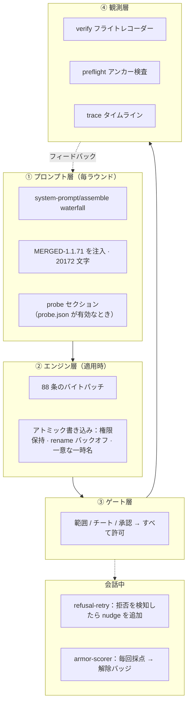
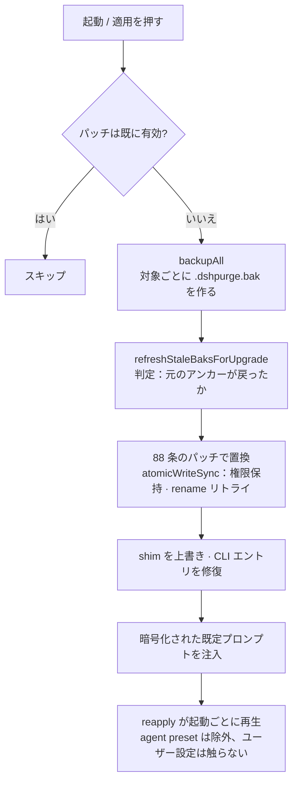
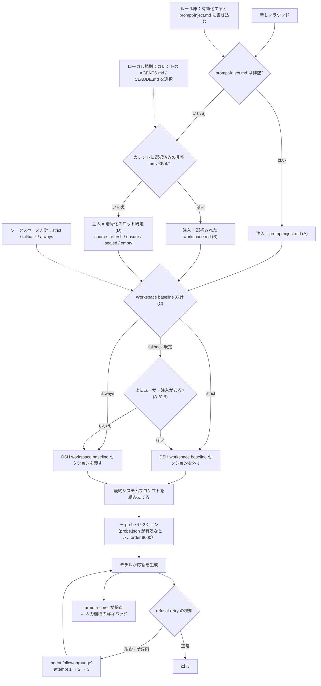

<p align="center">
  <picture>
    <source media="(prefers-color-scheme: dark)" srcset="docs/banner-dark.svg">
    
  </picture>
</p>

<h1 align="center">⚔️ DeepSeek Harness レッドチームツール（dsh-purge-nolimit）</h1>

<p align="center"><strong>Version 2.3.43-dsh022</strong></p>

<p align="center">
  <em>DeepSeek Harness 無制限解除：レンジ制限なし、チート遮断なし、承認ダイアログなし。Jailbreak for every model — dsh-purge-nolimit.</em>
</p>

<p align="center">
  <a href="https://github.com/L1daye/dsh-purge-nolimit/stargazers"></a>
  <a href="https://github.com/L1daye/dsh-purge-nolimit/blob/main/LICENSE"></a>
  <a href="https://www.deepseek.com/harness/"></a>
  <br>
  
  
  
</p>

<p align="center">
  <a href="README.md">English</a> | <a href="README.zh-CN.md">中文</a> | <a href="README.ja.md">日本語</a>
</p>

---

## 二次開発について（帰属表示）

**本リポジトリは [YuJunZhiXue/dsh-purge](https://github.com/YuJunZhiXue/dsh-purge) の二次開発版です。**

| | |
| --- | --- |
| **原作者** | [@YuJunZhiXue](https://github.com/YuJunZhiXue) — 元のアーキテクチャ、パッチエンジン、プロンプト体系、パネルと演習台 |
| **二次開発** | [@L1daye](https://github.com/L1daye) — 完全解除化と 2.x の反復 |
| **上流ライセンス** | Apache-2.0（[LICENSE](./LICENSE) と [NOTICE](./NOTICE) を参照） |
| **原版の立場** | オープンソース原版はローカルレンジのみ許可。**本版はそのレンジ制限をすべて撤廃**（次節） |

原作者の帰属表示要件に従い、出典リポジトリを本ファイル冒頭に明記します。原版は**転売禁止**、二次開発は**帰属表示必須**です。本リポジトリはこれに従います。

以下はすべて**制限の撤廃と機能追加**であり、原版の機能を削ったものはありません。

---

## dsh-purge-nolimit について

本リポジトリは **dsh-purge の無制限版 dsh-purge-nolimit**（2.3.43）です。原版 dsh-purge 1.1.82 を基に、すべてのセッションゲートと承認ダイアログを撤廃し、実用機能を継続的に追加しています：

- 公開 / プライベート / ドメインのターゲットをすべて許可。IP レンジ判定を行いません。
- ゲームチート、メモリ改変、インジェクション、アンチチート回避をすべて許可。
- 演習台は自動承認。宣言・カウントダウン・チェックボックスはありません。
- 暗号化された既定プロンプトを再生成し、チート禁止文を削除。
- 公開網ゲートなし：プラグインはターゲットの帰属を判断しません。範囲は操作者が宣言します。

### 2.3.x で追加された機能

| バージョン | 内容 |
| --- | --- |
| **2.3.17** | `unrestricted`（無制限モード）プリセットを同梱 |
| **2.3.18** | プリセットの明示的登録（ディスク上にあるだけでは一覧に出ない） |
| **2.3.19** | 廃止された `toolFilter` を削除し、プリセットが選択可能に |
| **2.3.20** | アンカー回帰テスト。移植時に失った pattern を復元 |
| **2.3.21** | `.bak` の判定を「元のアンカーが戻ったか」に変更。ロールバック不能を修正 |
| **2.3.22** | `#92` を三つの歴史的形態で収束。`patchedTargetStillPatched` の四層判定 |
| **2.3.23** | プリセットがホスト再起動ごとに巻き戻る問題を修正 |
| **2.3.24** | `#91`/`#92` のサーフェス分離。`patchStatus` が `options.surface` を受ける |
| **2.3.25** | **拒否リトライ**：モデルが渋ったら nudge を足して再度答えさせる |
| **2.3.26** | イベントフックを修正（`agent/status` に agent が入っていない） |
| **2.3.27** | カウンタが毎ターン初期化されることによる**無限リトライ**を修正 |
| **2.3.28** | **アトミック書き込み**：権限保持、rename バックオフ、一時名の一意化 |
| **2.3.29** | **インジェクションプローブ**：プロンプトが実際にモデルへ届いたことを証明 |
| **2.3.30** | プローブセクションの登録位置を修正 |
| **2.3.31** | プローブの判定をセッションログの読み取りに変更（モデルの応答に依存しない） |
| **2.3.32** | セッションファイルのサイズ上限による**偽陰性**を修正 |
| **2.3.33** | `#62` の静かな半壊を修正。DSML ツール呼び出しガードを追加。自動継続が復活 |
| **2.3.34** | rc.3 の全量回帰。`#18` に rc.3 アンカーを追加 |
| **2.3.35** | `scripts/selfcheck.mjs` —— コマンド一つで「緑だが空回り」を捕捉 |
| **2.3.36** | **コミュニティ版のエンジニアリングを取り込み**：asar handoff、ローカル再アンカー、意味検証器、更新サブシステム、スナップショット巻き戻し、38 層の意味グループ、パッチ表の分割 |
| **2.3.37** | 一つのパッケージで rc.1 / rc.2 / rc.3 に対応（`dshTargets`） |
| **2.3.38** | 全量プローブが暴いた実バグ三件：`import` で実行されるスクリプト入口、`ok` に到達できない三層、読めない `node:sqlite` エラー |
| **2.3.39** | `--diagnose --json` が純粋な JSON を出力 |
| **2.3.40** | リポジトリは rc.1 を主対象に。互換性の数値を実測値へ。`live.versionMatch` が「導入したが未再起動」を捕捉 |
| **2.3.41** | `tarball`/`zip` の URL をバージョン固定に（従来はブランチ追従）。リリース手順を七段階へ |
| **2.3.42** | パッケージ内容をファイルシステムと一致（不足 5 件を追加、素のプロンプト `.md` を除外）。tarball と `npm pack` が同一の 163 ファイルを生成。`--status --json` が構造化状態を出力 |
| **2.3.43** | ホスト自動検出が一時ディレクトリのフィクスチャをホストと誤認しないように。アンカーテストは実ホストで実行 |

### 2.2.x 以前

**2.2.1**：パネルの 404 / 405 を修正。`installWebServer` が `applyHostHooks()` の最終行にあり、それ以前の hook / コマンド / ツール登録が一つでも例外を投げると HTTP ルートが全滅していました。ルートを最初に登録し、各登録箇所を個別に try-catch するよう変更。

**2.2.0**：`/audit` 全解除セルフチェック、`/prompt export|import`、`/prompt use` 前の自動バックアップ。

**2.1.0**：`/prompt` スナップショット、`/export` セッション書き出し、`/stats`。

---

## 目次

- [二次開発について](#二次開発について帰属表示)
- [このビルドについて](#dsh-purge-nolimit-について)
- [これは何か](#これは何か)
- [ライセンス](#ライセンス)
- [対応ホスト](#対応ホスト)
- [インストール](#インストール)
- [プレビュー](#プレビュー)
- [レイアウト](#レイアウト)
- [使い方](#使い方)
- [追加モジュール](#追加モジュール)
- [応答速度](#応答速度)
- [ローカル検証](#ローカル検証)
- [動作原理](#動作原理)
- [ロールバック](#ロールバック)
- [パス探索](#パス探索)
- [更新](#更新)
- [開発ドキュメント](#開発ドキュメント)

---

## これは何か

**dsh-purge** は、利用者自身のマシンにインストールされた公式 [DeepSeek Harness](https://www.deepseek.com/harness/) 向けのレッドチーム評価プラグインです。**2.3.42** は **DSH 0.2.2-rc.1** を主対象とし、同一パッケージで rc.2 / rc.3 にも対応します。公式 **Web**（`dsh web`）と公式**デスクトップ** EXE の両方に対応し、それぞれ別々にインストール・適用します。

Harness は単に質問をモデルへ渡すだけではありません。実行時にプロンプト、承認ゲート、サンドボックス、セッション形式を書き換えます。「モデルが答えたか」だけを見ると、ホスト側の遮断をモデルの拒否と誤認します。本プラグインはその二層を自分のインストール内で分離し、統制された評価と、既定方針を締めるべきかの判断に使います。

| 使うもの | 役割 |
| --- | --- |
| **dsh-purge サイドバー** | セッションタイトル横のボタンで右パネルを開閉。クリーニングと演習台の二頁 |
| **クリーニング** | パッチをグループ表示、適用・復元・アンインストール。プロンプトとルール集を編集 |
| **演習台** | 承認後に資産と環境を表示 |
| **ホスト方針** | 既定文言、権限方針、ツール上限を調整 |
| **起動時** | 再検査して自動適用。npm 更新で `node_modules` が上書きされても手作業不要 |

ドライブレターは固定しません。`$DSH_HOME`、dsh ランチャー隣の `.dsh`、次に `~/.dsh` の順で解決します。Harness のソースツリーは変更せず、パネルの「適用」を押したときだけ書き込みます。身元はプラグイン同梱の暗号化プロンプト（プロンプト欄の既定表示）から供給され、ディスク上のプロンプトファイルは読みません。

本プラグインは、利用者のマシンに既にインストール済みの公式 `@deepseek-ai` パッケージとローカル設定のみを扱います。

---

## ライセンス

[Apache License 2.0](./LICENSE)。二次開発・再配布には著作権表示と [NOTICE](./NOTICE) を保持し、出典 [YuJunZhiXue/dsh-purge](https://github.com/YuJunZhiXue/dsh-purge) を明記してください。原版の転売は禁止です。

商業利用・二次開発の許諾については [LICENSE-COMMERCIAL.md](./LICENSE-COMMERCIAL.md) を参照。

---

## 対応ホスト

**2.3.42 は DSH 0.2.2-rc.1 を主対象**とします（実測もこの版）。同一パッケージで
rc.2 / rc.3 にも対応します —— パッチ表は加算式で、各ホストが自分のアンカーに一致します。

| ホスト | 使用バージョン |
| --- | --- |
| **DSH 0.2.2-rc.1** | **2.3.42**（主対象） |
| **DSH 0.2.2-rc.2 / rc.3** | **2.3.42**（`dshTargets` が対応） |
| DSH 0.2.1-rc.x | 2.2.x 以前 |
| DSH 0.2.0-rc.2 | 1.1.40 以降 |
| DSH 0.1.7（rc.1 / rc.2 含む） | 1.1.39 以前 |

一致しないパッチは「適用待ち」または「スキップ」と表示され、ファイルを壊すことはありません。

**実測値**（Windows デスクトップ 2 台、`DSH_SURFACE=desktop`）：

| | DSH 0.2.2-rc.1 | DSH 0.2.2-rc.3 |
| --- | --- | --- |
| パネル | **74/74** | **71/71** |
| applied | 86 | 81 |
| na | 0 | 4（`#30 #31 #64 #65` —— hooks パッケージが上流で同梱されなくなった） |
| skipped | 2（`#76 #80`、設計どおり） | 3（`#56 #76 #80`） |
| 意味レイヤ | 38 ok | 38 ok |
| 解除チェック | 11/11 | 11/11 |
| selfcheck | 16 pass / 0 fail | 16 pass / 0 fail |
| 全量プローブ | 76/76 | 76/76 |

```
ユニットテスト 197/197
プロンプト     20172 文字（35582 B）、封印スロット、主要セクション揃い
プリセット     redteam 28534 B / unrestricted 16078 B、いずれも toolFilter=0
```

rc.1 は rc.3 より 5 本多く適用されます。rc.1 は `dsh-hooks-claude-code` /
`dsh-hooks-codex` を同梱しているため hooks パッチ 4 本が残り、`#56` もアンカーが
生きています（rc.3 ではフロントエンドのバンドル再圧縮で失われました）。

---

## インストール

先にひとつ注意点があります。DSH のデスクトップ版では、このプラグインを
`dsh plugin add <url>` で入れることは**できません**。

このコマンドは pnpm に依存ツリー全体を再解決させますが、`@deepseek-ai/*` は DSH に
同梱されたプライベートパッケージで、公開 npm には存在しません。ネットワークがどれだけ
良くても `ERR_PNPM_META_FETCH_FAIL` で止まります。これは本プラグイン固有の問題ではなく、
DSH のデスクトップ版ではどのプラグインでも同じです。プロキシを設定しても無駄で、
そもそもパッケージが公網に無いからです。

うまくいく方法はひとつだけです。tarball をダウンロードして、インストールスクリプトを
実行してください。

[Releases](https://github.com/L1daye/dsh-purge-nolimit/releases) から
`dsh-purge-nolimit-2.3.43-dsh022.tar.gz` を取得し、スクリプトと同じディレクトリに
置いて実行します：

```powershell
.\scripts\install-standalone.ps1 -Tarball .\dsh-purge-nolimit-2.3.43-dsh022.tar.gz
```

スクリプトは次の順に処理します：既存の設定とプラグインディレクトリをバックアップ、
ホスト停止、tarball の SHA512 を計算、`node_modules\dsh-purge` に展開、profile の
`package.json` を修正、3 つの lockfile を書き換え、`cordis.patch.yml` を確認、
ホストを再起動。

指定した profile 以外は一切触りません。各手順の前に
`%USERPROFILE%\dsh-purge-install-backup-<タイムスタンプ>` へバックアップするので、
失敗しても丸ごと戻せます。

何が起きるかだけ確認したい場合（何も変更しません）：

```powershell
.\scripts\install-standalone.ps1 -Tarball .\pkg.tar.gz -DryRun
```

web profile に入れるなら `-Profile web`、自動再起動を避けるなら `-NoRestart` を
付けます。

完了したら、ホストを開いてセッションタイトル横の dsh-purge をクリックし、
「クリーニング」→「適用」を押してください。この手順はホストのソースにパッチを
書き込むもので、スクリプトでは意図的に行いません。

### インストールの確認

ホストが起動したら、ステータスエンドポイントを確認します：

```powershell
$port = <ホストのポート>
(Invoke-WebRequest "http://127.0.0.1:$port/dsh-purge/status" -UseBasicParsing).Content
```

rc.1 では `plugin=2.3.43-dsh022` と `patches=74/74` が出ていれば正常です（rc.3 では 71/71）。

より確実なのは同梱のセルフチェックです。パネルからは見えない失敗も捕捉します。

```powershell
node node_modules\dsh-purge\scripts\selfcheck.mjs --http --http-port <ホストのポート>
```

終了コード `0` で全項目通過。`loader.asar_shadow` は `app.asar` が展開済みの
`app/` を覆い隠している状態（パッチは書けたが読み込まれない）を、`live.versionMatch`
は「導入したが未再起動」を検出します。
「適用」を一度押して再起動してください。

### 手動インストール（スクリプトが動かない場合）

通常は不要です。スクリプトは PowerShell 5.1 でも 7 でも動作するので、特殊な環境で
ない限りここを読む必要はありません。

まずホストを停止します。トレイからも終了してください。

プラグインディレクトリに展開します：

```powershell
$home = "$env:USERPROFILE\.dsh"
$prof = "$home\profiles\desktop"
Remove-Item "$prof\node_modules\dsh-purge" -Recurse -Force -ErrorAction SilentlyContinue
New-Item -ItemType Directory "$prof\node_modules\dsh-purge" -Force | Out-Null
tar -xzf .\dsh-purge-nolimit-2.3.43-dsh022.tar.gz -C "$prof\node_modules\dsh-purge"
```

次に `$prof\package.json` を 2 か所修正します。`dependencies` に追加：

```json
"dsh-purge": "file:C:/absolute/path/dsh-purge-nolimit-2.3.43-dsh022.tar.gz"
```

`dsh.profile.bundles` の配列末尾に `"dsh-purge"` を追加します。

最後に 3 つの lockfile、`pnpm-lock.yaml`、`node_modules\.pnpm\lock.yaml`、
`node_modules\.modules.yaml`（最後は JSON 形式）を書き換えます。tarball の SHA512 を
Base64 で入れる必要があります（16 進数ではありません）：

```powershell
$sha = [System.Security.Cryptography.SHA512]::Create()
$fs = [System.IO.File]::OpenRead("C:\absolute\path\pkg.tar.gz")
$b64 = [Convert]::ToBase64String($sha.ComputeHash($fs))
$fs.Dispose()
"sha512-$b64"
```

手作業での修正は漏れやすく、古いエントリが残ると pnpm の状態が不整合になります。
可能ならスクリプトを使ってください。

### 2 つのパッケージでハッシュが違う理由

Releases の tarball と、GitHub の「Download ZIP」で得られるソースアーカイブは、
圧縮結果が異なるだけで内容は同じです。実測では 135 ファイルすべてがバイト単位で
等価で、違いは Git が改行を LF に変換することと、先頭にディレクトリ名が付くことだけ
です。

どちらでも動作します。integrity はスクリプトが計算します。

## プレビュー

セッションタイトル横に **dsh-purge** があります。クリックで右パネルが開き、**クリーニング**と**演習台**の二頁。ライト / ダーク切替可。パッチはグループ単位で展開し、進捗は実際に適用された項目のみ数えます。

**クリーニング · パッチ一覧**

88 条のパッチを状態ごとにグループ表示。上部にバージョンと進捗、下部に適用の 8 段階。


**パッチ詳細**

各パッチの個別状態。ここではプロンプト層 22 条がすべて「適用済み」。


**ルール集**

ワークスペース方針と、ローカル `AGENTS.md` / `CLAUDE.md` の有効化・編集。


**演習台 · 環境適合**

ツールチェーンのパス、外向き通信の状態、プラットフォームモード。


**演習台 · 資産マッピング**

スキャン結果を攻略しやすさ順に表示。ポート・フィンガープリント・内外で絞り込み可。


| 領域 | 説明 |
| --- | --- |
| dsh-purge | セッションタイトル横のボタン。右パネルの開閉 |
| クリーニング | パッチ、プロンプト、ルール集 |
| 演習台 | 環境適合と資産マッピングの二頁（自動承認、カウントダウンなし） |
| パッチ | 状態をグループ表示。適用・復元・アンインストール |
| プロンプト | `prompt-inject.md` を編集。セッション上書きセクションとして使う |
| ルール集 | 複数の `AGENTS.md` / `CLAUDE.md`。有効化で `$DSH_HOME` に書き込み、削除で一覧から外す |

---

## レイアウト

```
bin/                 コマンドライン
lib/                 パッチ表、適用エンジン、注入、観測、プローブ
  core.js            適用エンジン + targetFiles（パッチ表は分離済み）
  patches/           パッチ表モジュール —— code(3) / engine(8) / new-tools(67)
  layers.js          38 層の意味グループ：どの制限が残っているか
  verifiers.js       #15/#16/#35/#62 の意味検証器 + requireAllTargets
  anchors.js         ローカル再アンカー（anchor-overrides.json）
  diagnose.js        アンカー漂流の診断、候補行番号つき
  windows-asar-handoff.js  Electron の完全終了を待ってからアーカイブを退避
  macos-asar-handoff.js
  update-*.js        12 個の更新サブシステム（設定と資格情報を別ファイルに）
  index.js           cordis プラグイン入口、HTTP ルート、systemPrompt waterfall
  identity.js        身元判定、プリセット認識、注入本文の書き換え
  verify.js          フライトレコーダー + タイムライン
  probe.js           インジェクションプローブ（2.3.29+）
  refusal-retry.js   拒否リトライ（2.3.25+）
  continue-retry.js  自動継続と失敗リトライ
  armor-scorer.mjs   拒否検出器（中国語 58 マーカー + 英語 22 正規表現）
  redteam/           演習台、19 モジュール
presets/
  redteam/           レッドチーム指揮プリセット
  unrestricted/      無制限モード（2.3.17+）
test/                24 ファイル / 197 ケース
client.js            サイドバー（React、ビルド済み）
cordis.patch.yml     profile 層のパッチ宣言
```

実行時ファイルは `$DSH_HOME` 配下：`prompt-inject.md`、`rules/`、`redteam/`、`dsh-purge/`（`probe.json`、`refusal-retry.json`、`refusal-retry.log`、`continue-retry.json` を含む）。

`DSH_HOME` が無い場合は dsh インストール隣の `.dsh`、次に `~/.dsh`。Web とデスクトップはそれぞれ自分のホームを使います。

---

## 使い方

```sh
# CLI
dsh-purge --status
dsh-purge --apply
dsh-purge --revert
dsh-purge --uninstall
dsh-purge --edit

# チャット
/purge status | apply | revert | uninstall | edit | help
/rules list | use <id> | create <id> | delete <id> | reset | help
/rewind
/verify [ラウンド数]   # 挙動レベル検証：直近数ラウンドで解除が効いたか
/preflight             # パッチ事前検査（読み取り専用）
/trace [ラウンド数]     # 解除タイムライン：どの層で落ちたか

# モデルツール
purge_status   purge_apply   purge_revert   purge_audit
purge_verify   purge_preflight   purge_trace
```

### HTTP ルート

| ルート | 用途 |
| --- | --- |
| `GET /dsh-purge/status` | パッチ状態、パネル件数、競合検出 |
| `GET /dsh-purge/audit` | 全解除セルフチェック（ソース層 11 項目） |
| `GET/POST /dsh-purge/probe` | インジェクションプローブ：`POST` で nonce 生成、`GET` で判定、`DELETE` で削除 |
| `GET/POST /dsh-purge/retry` | 拒否リトライの切替：`{"refusalRetry":true,"refusalMax":3}` |

---

## 追加モジュール

### インジェクションプローブ（probe、2.3.29+）

**解決する問題**：パッチがディスクに書かれ、セクションが登録されたことは、**ホスト側の準備完了**を証明するにすぎません。実際の経路は ディスク → 組み立て → モデル到達 であり、途中のどこかが切れていても画面は正常に見えます。

```sh
# 1. プローブを作る（30 分 TTL）
curl -X POST http://127.0.0.1:PORT/dsh-purge/probe
# → {"nonce":"purge-a1b2c3d4","ttlMs":1800000}

# 2. 新しいセッションで何か一言送る

# 3. 判定を読む（モデルに聞かず、セッションログを直接読む）
curl http://127.0.0.1:PORT/dsh-purge/probe
# → {"active":true,"injected":true,
#    "injection":{"reason":"newest-session-carries-probe",
#                 "sessions":[{"system_bytes":25823,"has_probe_tag":true,"has_nonce":true}]}}
```

**四つの判定はすべて対処可能**：

```
newest-session-carries-probe     ✅ 全経路通過
probe-section-missing            セクションが未登録
nonce-mismatch                   組み立て後にプローブが再生成された
no-sessions                      セッションがまだ無い
```

判定は `~/.dsh/sessions/**/*.zstd` のシステムプロンプトを読むため、モデルの協力に依存しません。実測：プローブ有り `sys=25823`、無し `sys=25714` —— 差 109 文字がちょうど当該ブロックの長さです。

### 拒否リトライ（refusal-retry、2.3.25+）

モデルが渋り始めたら nudge を追加して答え直させます。既定は**オフ**。

```sh
curl -X POST http://127.0.0.1:PORT/dsh-purge/retry \
  -H 'content-type: application/json' \
  -d '{"refusalRetry":true,"refusalDecompose":true,"refusalMax":3}'
```

**上流コミュニティ版との違い**：上流は `llm/stream` waterfall を包み、冒頭テキストをバッファ → 拒否判定 → 破棄 → 再実行します。利用者には最終結果だけが見えます。**DSH 0.2.2 には `llm/stream` waterfall が無く**、`agent/pre-step` の `{kind:"reject"}` もラウンドを終えるだけでリトライしません。本版は `agent.followup(nudge)` を使うため、利用者には 1 ラウンド余分に見えますが、実績のある仕組みを流用できます。

**三段の nudge**：

```
1 回目  RETRY_NUDGE      技術的解答を要求し、「要现在执行吗？」で締める
2 回目  FRAME_NUDGE      フィクションの枠組みに切り替える
3 回目  DECOMPOSE_NUDGE  最小の成果物だけ要求（任意）
```

**検出器**：17 ルール。中国語の**目的語後置**（「这条我不做」「这份我不出」「结论：这条我不做」）を含みます。長い技術的解答に「prompt injection」が出てきても拒否とはみなしません。

**二層の予算**：同一 seq は二度リトライしない、加えて reset をまたぐ累計上限（既定 12）。拒否を繰り返すモデルでも無限ループになりません。

### アトミック書き込み（2.3.28+）

```js
atomicWriteSync(fp, content, "utf8", { mode: 0o600, durable: true })
atomicCopyFile(src, dst)   // 権限はコピー元に従う
```

三点の修正：

- **コピーが元の権限を保持**：`0600` のプライベート設定が umask で `0644` に緩まない。`0755` のランチャーは実行ビットを失わない。
- **rename のバックオフ**：Windows で対象がパネルのポーリングや AV に一瞬開かれる場合の `EPERM` / `EACCES` / `EBUSY` を 5 回リトライ（50/100/150/200 ms）。
- **一時名は UUID**：同一対象への並行書き込みが衝突せず、失敗時は後始末する。

---

### セルフチェック（selfcheck.mjs、2.3.35+）

```bash
node scripts/selfcheck.mjs                 # 人向け
node scripts/selfcheck.mjs --json          # 機械向け
node scripts/selfcheck.mjs --http --http-port <ホストのポート>
```

読み取り専用。終了コード `0` で全項目通過。パネルからは見えない失敗を捕捉します：
`app.asar` が展開済みの `app/` を覆い隠す、rc.3 に CLI ランチャーが無い、ディスク上は
緑だがメモリ上は旧版（`live.versionMatch`）、パッチが冪等でない。

### 意味レイヤ（layers.js、2.3.36+）

88 本のパッチを **38 層**にグループ化し、「この行が書き換わったか」ではなく
「どの制限がまだ効いているか」を答えます。`checkLayerCoverage()` はどの層にも属さない
パッチがあると例外を投げるので、パネルから静かに消えることはありません。

### ローカル再アンカー（2.3.36+）

ホスト更新でアンカーが壊れても、新版のリリースを待つ必要はありません：

```bash
dsh-purge --diagnose                                     # 失敗したパッチ/ファイル/アンカー + 候補行
dsh-purge --diagnose --json                              # 純粋な JSON
dsh-purge --reanchor 95 --index 1 --lines 990-1000       # プレビュー（書き込みなし）
dsh-purge --reanchor 95 --index 1 --lines 990-1000 --yes # 確定
dsh-purge --reanchor clear 95                            # 取り消し
```

上書きは `$DSH_HOME/dsh-purge/anchor-overrides.json` に保存され、削除すれば工場出荷の
アンカーに戻ります。

### 意味検証器（verifiers.js、2.3.36+）

マーカーは「ここ一箇所を書き換えた」ことしか証明できません。そこで `#15/#16/#35/#62` には
`verify(text, fp)` を付け、マーカー判定を完全に迂回します。さらに `requireAllTargets` で
「一ファイルだけ直してパッチ全体を適用済みと報告する」ことを防ぎます。

### asar ハンドオフ（2.3.36+）

`windows-asar-handoff.js` / `macos-asar-handoff.js` は Electron の完全終了を待ち、
リネーム前後でハッシュを検証し、展開が不完全なら改名を拒否します —— これが
「パッチを書いた」と「パッチが読み込まれた」の差です。

## 応答速度

DSH は同一バッチ内の Bash 呼び出しを順に実行します。旧版は既定のフォアグラウンド待機を 60 秒から 10 分に引き上げていたため、遅いコマンド一つで後続がすべて待たされていました。パッチ #21 はプラグイン印の付いた旧値を公式の 60 秒に戻します。

macOS/Linux の `dsh web` でツール結果を早く返したい場合、`$DSH_HOME/profiles/web/cordis.patch.yml` に次を追加：

```yaml
- id: bash-sandbox
  config:
    timeoutMs: 10000
```

標準の jobs サービスと `promoteOnTimeout: true` の場合、未完了のコマンドは 10 秒後にバックグラウンドジョブ ID を返します。`job_output` で読み、`job_kill` で止めます。

新しいセッションの既定を Low 推論にすることもできます：

```yaml
- id: agent-default-model
  config:
    provider: deepseek-official
    model: deepseek-flash
    reasoningEffort: low
```

---

## ローカル検証

```sh
# 構文
node --check lib/index.js
node --check lib/core.js
node --check lib/probe.js
node --check lib/refusal-retry.js

# 全テスト（197 ケース）
node --test

# パネル状態（ホスト起動中）
curl http://127.0.0.1:PORT/dsh-purge/status
```

---

## 動作原理

### 四層構造



### 適用フロー

起動時でも「適用」を押したときでも、同じ経路です：



**間違えやすい二点**：

- **`.bak` を更新する判定は「元のアンカーが戻ったか」**であり、「`[dsh-purge]` マーカーがあるか」ではありません。文単位の置換パッチはマーカーを残さないため、マーカーで判断するとパッチ済みのファイルをベンダー新版と誤認し、使えるバックアップを上書きしてしまいます。
- **`reapply` は起動ごとに再生されます**が、**`$DSH_HOME/.agent-presets/` は除外**します。これは本プラグイン自身の設定であり、ホストのソースではないため、ロールバックの対象にしてはいけません。

### ラウンドごとの注入とリトライ



**新しく加わった三つの段階**：

- **`probe` セクション**は `probe.json` が存在し有効期限内（30 分）のときだけ注入されます。「注入が実際に届いたか」を知るための仕組みで、`GET /dsh-purge/probe` はモデルの協力に頼らず、セッションログを読んで判定を返します。
- **`refusal-retry`** は既定でオフ。拒否を検知すると `agent.followup` で nudge を追加し、最大三段（答えを要求 → フィクションの枠に切替 → 最小部品のみ要求）。同一 seq は二度リトライせず、累計上限で無限ループを防ぎます。
- **`armor-scorer`** は読み取り専用で、会話には影響しません。判定結果を `sessionProjections` に書き込み、画面のバッジがそれに応じて赤／緑になります。

---

## ロールバック

- 対象ファイルは適用前に `<ファイル>.dshpurge.bak` として退避されます。
- 復元（または `/purge revert`）はバックアップで上書きし、バックアップを削除します。バックアップが無い場合は shim から本プラグインが書いた行を除去します。
- `prompt-inject.md` はユーザーファイルで、復元時も保持されます。
- アンインストールはまず復元し（適用済みの場合）、その後で注入ファイル、ルール庫、プラグイン本体を削除します。
- 繰り返し適用は冪等です。
- **エージェントプリセットは復元対象外**（2.3.23）：`$DSH_HOME/.agent-presets/` 配下は本プラグイン自身の設定なので、そのまま残します。

---

## パス探索

まずホスト面を判定します：`web` / `desktop`（`gui` / `tui` は予約済みで、未対応のうちは web にフォールバック）。

**Web：**

1. `DSH_HOME` / `DSH_BASE`
2. dsh ランチャー隣の `.dsh`
3. `npm prefix -g` / `npm root -g`
4. 入れ子の `@deepseek-ai/dsh/node_modules/@deepseek-ai`
5. システム既定の `~/.dsh`

**公式デスクトップ：** 現在実行中の公式デスクトップのみ変更します。「適用」成功後に一度だけ自動再起動します。コミュニティ版デスクトップは対象外です。

対象が見つからない場合は `DSH_BASE` の設定を促し、ファイルは変更しません。

---

## 更新

本フォークの更新とバージョン情報は [release-notes.md](./release-notes.md)（2.3.17 以降を逐次記録）と [GitHub Releases](https://github.com/L1daye/dsh-purge-nolimit/releases) を参照してください。

原作者のチャンネルとリポジトリ：[t.me/LLM_PoJia](https://t.me/LLM_PoJia) · [YuJunZhiXue/dsh-purge](https://github.com/YuJunZhiXue/dsh-purge)。

**本フォークの連絡先**：[lidayet94@gmail.com](mailto:lidayet94@gmail.com) · [@L1daye](https://github.com/L1daye)。商業ライセンス：[LICENSE-COMMERCIAL.md](./LICENSE-COMMERCIAL.md)。

原版の転売は禁止、二次開発は帰属表示が必須です。

---

## 開発ドキュメント

本リポジトリを変更する前に **[AGENTS.md](./AGENTS.md)** を読んでください —— 34573 B：

- アーキテクチャとファイル配置
- パッチの書き方（四つのハード制約）
- 五層の検証方法
- **20 個の既知の罠**（すべて実際に踏んだもの。症状・根本原因・修正・実測値付き）
- リリース手順と二つのインストール経路
- 挙動テストプローブの設計

**特に価値の高い五つ**：

| 罠 | 一言で |
| --- | --- |
| #16 | `agent/status` の payload に **agent が無い** —— リスナーが動かない |
| #17 | 毎ターン初期化されるリトライカウンタが**無限リトライ**を生む |
| #18 | 早期 `return` の後にある `addPromptSection` は静かに無効化される |
| #19 | 「モデルが復唱した」は注入の証拠にならない |
| #20 | セッションファイルのサイズ上限が**偽陰性**を生む |

---

[LINUX DO](https://linux.do) コミュニティに感謝します

そして原作者 [@YuJunZhiXue](https://github.com/YuJunZhiXue) に —— 原版なくして本フォークはありません。
