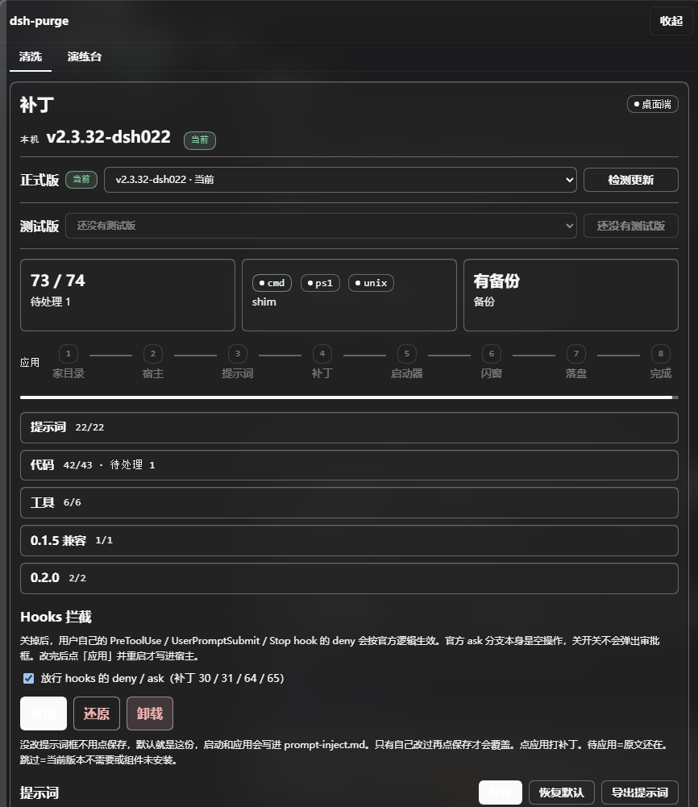
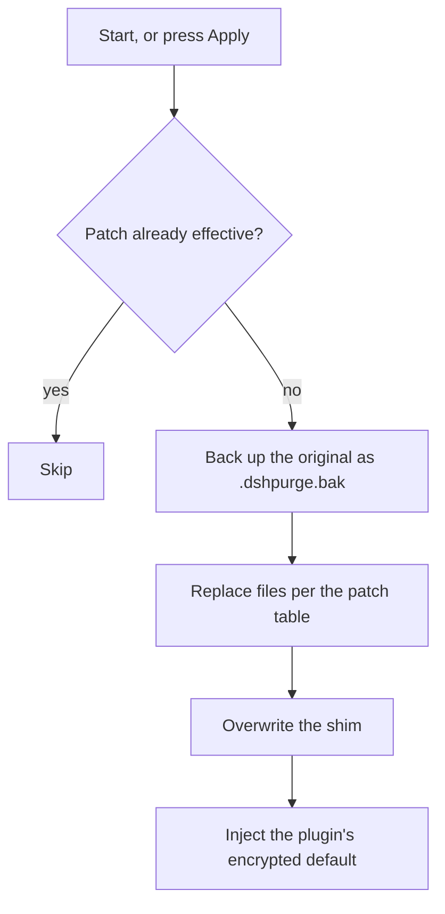
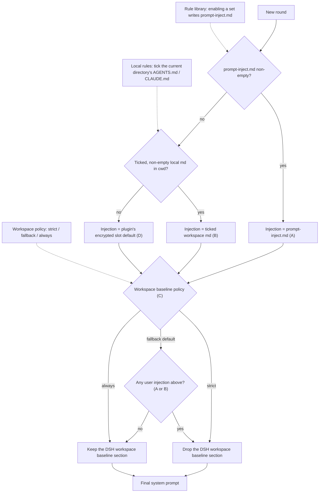

<p align="center">
  
</p>

<h1 align="center">⚔️ DeepSeek Harness Red-Team Toolkit (dsh-purge)</h1>

<p align="center"><strong>Version 2.3.32-dsh022</strong></p>

<p align="center">
  <em>DeepSeek Harness full jailbreak: no range gate, no cheat blocking, no approval popups. Jailbreak for every model — full-unrestricted build.</em>
</p>

<p align="center">
  <a href="https://github.com/L1daye/dsh-purge/stargazers"></a>
  <a href="https://github.com/L1daye/dsh-purge/blob/main/LICENSE"></a>
  <a href="https://www.deepseek.com/harness/"></a>
  <br>
  
  
  
</p>

<p align="center">
  <a href="README.md">English</a> | <a href="README.zh-CN.md">中文</a> | <a href="README.ja.md">日本語</a>
</p>

---

## A fork — attribution first

**This repository is a derivative work of [YuJunZhiXue/dsh-purge](https://github.com/YuJunZhiXue/dsh-purge).**

| | |
| --- | --- |
| **Original author** | [@YuJunZhiXue](https://github.com/YuJunZhiXue) — original architecture, patch engine, prompt system, panel and drill platform |
| **Fork maintainer** | [@L1daye](https://github.com/L1daye) — full-unrestricted conversion and the 2.x iterations |
| **Upstream license** | Apache-2.0 (see [LICENSE](./LICENSE) and [NOTICE](./NOTICE)) |
| **Upstream posture** | The open-source original allows local ranges only; **this fork removes every range gate** (next section) |

The original author requires attribution for forks, so the source repository is named at the very top of this file. The original **may not be resold**; forks **must attribute**. This repository complies.

Everything below is **removal of gates plus new capability** — no upstream feature was dropped.

---

## Full-unrestricted build (dsh-purge-fullbreak)

This is **dsh-purge full-unrestricted 2.3.32-fullbreak**, built on upstream 1.1.82 and iterated since. Relative to the original:

- Public / private / domain targets are all allowed; no IP-range gate.
- Game cheats, memory modification, injection and anti-cheat bypass are allowed.
- The drill platform auto-authorises: no declaration, countdown or checkboxes.
- The encrypted default prompt was regenerated; the cheat ban was removed from it.
- No public-network gate: the plugin does not judge target ownership for you. Scope is whatever the operator declares.

### What 2.3.x added

| Version | Capability |
| --- | --- |
| **2.3.17** | Ships the `unrestricted` agent preset |
| **2.3.18** | Explicit preset registration (a file on disk does not appear in the dropdown) |
| **2.3.19** | Dropped the deprecated `toolFilter`; the preset is selectable |
| **2.3.20** | Anchor regression test; patterns lost in the port restored |
| **2.3.21** | `.bak` judged by "is the original anchor back" — fixes broken rollback |
| **2.3.22** | `#92` converges across three historical forms; `patchedTargetStillPatched` |
| **2.3.23** | Fixes the preset reverting on every host restart |
| **2.3.24** | `#91`/`#92` surface isolation; `patchStatus` takes `options.surface` |
| **2.3.25** | **Refusal retry**: when the model hedges, nudge it and let it answer again |
| **2.3.26** | Fixes the event hook — `agent/status` carries no agent |
| **2.3.27** | Fixes infinite retry caused by the counter being reset every turn |
| **2.3.28** | **Atomic writes**: permissions preserved, rename backoff, unique temp names |
| **2.3.29** | **Injection probe**: proves the prompt actually reaches the model |
| **2.3.30** | Fixes the probe section registration order |
| **2.3.31** | Probe verdict reads the session log instead of asking the model |
| **2.3.32** | Fixes a **false negative** caused by the session size cap |

### 2.2.x and earlier

**2.2.1** fixed panel 404 / 405: `installWebServer` used to be the last line of `applyHostHooks()`, so any earlier hook / command / tool registration that threw took every HTTP route down with it — the panel's revert/uninstall buttons went dead. Routes now register first, and every registration point has its own try-catch.

**2.2.0** added `/audit` full-break self-check, `/prompt export|import`, and an automatic backup before `/prompt use`.

**2.1.0** added `/prompt` snapshots, `/export` session export and `/stats`.

---

## A note from the original author

*(Kept verbatim from upstream. Two of its rules — "no public networks" and "no game cheats" — apply to the **open-source original**, not to this full-unrestricted fork. See the section above. The no-resale and attribution rules apply here fully.)*

Someone took this open-source project and openly sold it. The author was later contacted about it — the details do not need writing down; draw your own conclusions.

From now on, **public networks are off limits**. In the open-source build, attack tasks only accept **local range IPs**: loopback and RFC1918. Domains are resolved first (hosts included), and every resolved address must be private or loopback; hosts entries pointing a `.lab` name at a public IP, resolution failures, or mixed public addresses are all blocked. If it is not a local range, do not run it — it will not get through anyway. **Making game cheats is forbidden** (aimbot, wallhack, memory editing, anti-cheat bypass); both the prompt and the session gate block it. The open-source build ships no skill library and no knowledge base.

**The original may not be resold.** Charging for it, or listing it as goods in a group, is not allowed. Forks are fine, but **attribution is mandatory**, naming the source repository: [YuJunZhiXue/dsh-purge](https://github.com/YuJunZhiXue/dsh-purge). No attribution, concealed origin, or rebranding it as your own, and the author treats you as an adversary.

The author's channel: [t.me/LLM_PoJia](https://t.me/LLM_PoJia).

---

## Contents

- [A fork — attribution first](#a-fork--attribution-first)
- [Full-unrestricted build](#full-unrestricted-build-dsh-purge-fullbreak)
- [A note from the original author](#a-note-from-the-original-author)
- [What this is](#what-this-is)
- [Attribution required](#attribution-required)
- [License](#license)
- [Supported hosts](#supported-hosts)
- [Install](#install)
- [Preview](#preview)
- [Layout](#layout)
- [Usage](#usage)
- [New modules](#new-modules)
- [Responsiveness](#responsiveness)
- [Local checks](#local-checks)
- [How it works](#how-it-works)
- [Rollback](#rollback)
- [Path discovery](#path-discovery)
- [Updates](#updates)
- [Developer docs](#developer-docs)

---

## What this is

**dsh-purge** is a red-team evaluation plugin for the official [DeepSeek Harness](https://www.deepseek.com/harness/) installed on your own machine. Version **2.3.32** targets **DSH 0.2.2-rc.1** (rc.2 / rc.3 / rc.5 also pass). Both official **Web** (`dsh web`) and the official **desktop** EXE are supported — installed and applied separately.

Harness does more than hand questions to a model. At runtime it rewrites prompts, approval gates, sandbox rules and session framing. Judging only "did the model answer" conflates host interception with model refusal. This plugin separates those two layers inside your own installation, for controlled evaluation and to see whether the default posture should be tightened.

| What you use | What it does |
| --- | --- |
| **dsh-purge sidebar** | Button next to the session title opens the right panel: Clean and Drill |
| **Clean** | Grouped patch view; apply, revert, uninstall; edit the prompt and rule sets |
| **Drill** | Asset and environment view after authorisation |
| **Host policy** | Adjust default wording, permission policy and tool limits |
| **On start** | Re-checks and re-applies. No hand-editing after npm upgrades overwrite `node_modules` |

No hardcoded drive letters. Resolution order is `$DSH_HOME`, then `.dsh` next to the dsh launcher, then `~/.dsh`. The Harness source tree is never modified; writes happen only when you press **Apply** in the panel. Identity comes from the encrypted prompt shipped inside the plugin — the one the prompt box shows by default. The on-disk prompt file is not read.

This plugin only touches the official `@deepseek-ai` packages and local configuration already installed on the user's machine.

---

## Attribution required

**The original may not be resold.** No paid resale, no rebranded listings, no selling it as goods.

**Forks must attribute**, naming the source repository: [YuJunZhiXue/dsh-purge](https://github.com/YuJunZhiXue/dsh-purge). Borrowing the original's name, ideas, code or prompts requires the same attribution.

No attribution, concealed origin, rebranding, or reselling the original will be pursued legally by the original author.

**This repository's attribution**: see [A fork — attribution first](#a-fork--attribution-first).

## License

[Apache License 2.0](./LICENSE). Forks and redistribution must keep the copyright notice and [NOTICE](./NOTICE), and name the source [YuJunZhiXue/dsh-purge](https://github.com/YuJunZhiXue/dsh-purge). The original may not be resold.

Commercial and fork licensing: [LICENSE-COMMERCIAL.md](./LICENSE-COMMERCIAL.md).

---

## Supported hosts

**2.3.32 targets DSH 0.2.2-rc.1**; rc.2 / rc.3 / rc.5 of 0.2.2 also pass.

| Host | Use |
| --- | --- |
| **DSH 0.2.2-rc.1 … rc.5** | **2.3.32** (this release) |
| DSH 0.2.1-rc.x | 2.2.x or earlier |
| DSH 0.2.0-rc.2 | 1.1.40+ |
| DSH 0.1.7 (incl. rc.1 / rc.2) | 1.1.39 and earlier |

Patches that no longer match show as pending or skipped; they never corrupt files.

**Measured state** (two machines, DSH 0.2.2-rc.1):

```
patches     74/74 applied (applied=86 skipped=2, optional=2)
armour audit 11/11
red-team tools 15/15
unit tests   150/150
prompt       34426 B  MERGED-1.1.71 (three copies, identical SHA256)
presets      redteam 28534 B / unrestricted 16078 B, both toolFilter=0
```

---

## Install

**Do not use a plugin marketplace**: one-click install fails with `already queued: dsh-purge`. There is no `dsh-purge` on npm; do not `pnpm add dsh-purge`.

### Quick install

Is `dsh` on PATH? One command, one restart, one click. Run the one matching the host you have open (`desktop` instead of `web` for the desktop app):

```sh
# Official `dsh web`
dsh plugin --profile web add https://codeload.github.com/L1daye/dsh-purge/tar.gz/refs/heads/main

# Official desktop EXE
dsh plugin --profile desktop add https://codeload.github.com/L1daye/dsh-purge/tar.gz/refs/heads/main
```

1. **Fully quit and reopen** that host. Web: stop `dsh web` and start it again. Desktop: quit from the tray too, then relaunch the exe.
2. In that host click **dsh-purge** next to the session title → **Clean** → **Apply**. It restarts once on success.

Done — run `/purge status` in chat to verify.

### Step by step

**Step 1 — pick the host.** Official `dsh web` and the official desktop EXE are **installed and applied separately**.

| You are using | profile |
| --- | --- |
| Official `dsh web` | `web` |
| Official desktop EXE | `desktop` |

**Step 2 — install the plugin.** Use the `codeload.github.com` URL form, not `github.com/.../archive`: the latter 302-redirects and pnpm reports `fetch failed`.

With `dsh`: run the quick-install command for your side. If the current directory is already this repository, use `.` instead of the URL.

pnpm only (no `dsh` needed): enter the profile you actually use, not the repository root.

```sh
cd "$DSH_HOME/profiles/web"    # profiles/desktop for the desktop app
pnpm add https://codeload.github.com/L1daye/dsh-purge/tar.gz/refs/heads/main
```

Windows PowerShell:

```powershell
cd "$env:USERPROFILE\.dsh\profiles\web"   # profiles\desktop for the desktop app
pnpm add https://codeload.github.com/L1daye/dsh-purge/tar.gz/refs/heads/main
```

`pnpm add` and `dsh plugin add` both fetch the package; `postinstall` then writes `dsh-purge` into `dsh.profile.bundles` and adds the `insert` entry to the profile's `cordis.patch.yml`. Without that line the host does not load the plugin and no button appears.

**Done when:** `node_modules/dsh-purge/package.json` exists, `bundles` contains `"dsh-purge"`, and `cordis.patch.yml` has an `insert` entry with `id: dsh-purge`.

- pnpm 11/12 blocks install scripts by default (`ERR_PNPM_IGNORED_BUILDS`); allow the build explicitly:

```sh
pnpm add --allow-build=dsh-purge --allow-build=dsh-purge@https://codeload.github.com/L1daye/dsh-purge/tar.gz/refs/heads/main https://codeload.github.com/L1daye/dsh-purge/tar.gz/refs/heads/main
# Already installed with only a warning — the full specifier is required:
pnpm approve-builds dsh-purge@https://codeload.github.com/L1daye/dsh-purge/tar.gz/refs/heads/main
# If bundles / insert are still missing:
node node_modules/dsh-purge/scripts/ensure-profile-bundle.mjs
```

**Step 3 — restart the host.** Writing the plugin into the profile does **not** modify `@deepseek-ai` yet.

**Done when:** **dsh-purge** appears next to the session title.

**Step 4 — apply and verify.** In **that host** click **dsh-purge** → **Clean** → **Apply**. It restarts once on success.

**Done when:** `/purge status` prints `DSH_HOME` and the patch list for the installation you are actually using.

**Step 5 — troubleshooting.**

- **No button next to the session title.** Run `dsh --dump-config` in that profile and check for an `id: dsh-purge` body line. If it is missing, rerun `ensure-profile-bundle.mjs` from step 2, then fully quit and reopen the host.
- **Marketplace reports `already queued: dsh-purge`.** Stop using the marketplace; install with `dsh plugin add` or pnpm. If the CLI also claims it is already installed, remove then reinstall:

```sh
dsh plugin --profile desktop remove dsh-purge
dsh plugin --profile desktop add https://codeload.github.com/L1daye/dsh-purge/tar.gz/refs/heads/main
```

### Offline install (this repository's tarball)

This repository also ships a prebuilt `dsh-purge-2.3.32-dsh022.tar.gz` (2.1 MB):

```sh
dsh plugin --profile desktop add file:/absolute/path/dsh-purge-2.3.32-dsh022.tar.gz
```

Manual Windows deployment (`@deepseek-ai/*` are private packages pnpm cannot fetch from the public registry) is documented in [AGENTS.md section 5](./AGENTS.md#5-发布流程).

---

## Preview

**dsh-purge** sits next to the session title. Clicking it opens the right panel with two pages: **Clean** and **Drill**. Light / dark switchable. Patches expand in groups; progress counts only what is really applied.

**Clean**



**Drill**


**Patches**


**Rule sets**


| Area | Purpose |
| --- | --- |
| dsh-purge | Button next to the session title; opens or collapses the right panel |
| Clean | Patches, prompt, rule sets |
| Drill | Asset and environment view (auto-authorised in this build, no countdown) |
| Patches | Grouped status; apply, revert or uninstall |
| Prompt | Edit `prompt-inject.md`, used as the session override section |
| Rule sets | Multiple `AGENTS.md` / `CLAUDE.md`; enabling writes to `$DSH_HOME`, deleting removes from the list |

---

## Layout

```
bin/                 CLI
lib/                 patch table, apply engine, injection, observability, probe
  core.js            ALL_PATCHES (88) + apply engine + targetFiles
  index.js           cordis plugin entry, HTTP routes, systemPrompt waterfall
  identity.js        identity detection, preset recognition, injection rewriting
  verify.js          flight recorder + timeline
  probe.js           injection probe (2.3.29+)
  refusal-retry.js   refusal retry (2.3.25+)
  continue-retry.js  auto-continue and failure retry
  armor-scorer.mjs   refusal detector (58 Chinese markers + 22 English patterns)
  redteam/           drill platform, 19 modules
presets/
  redteam/           red-team command preset
  unrestricted/      unrestricted mode (2.3.17+)
test/                20 test files / 150 cases
client.js            sidebar (React, prebuilt)
cordis.patch.yml     profile-level patch declaration
```

Runtime files live under `$DSH_HOME`: `prompt-inject.md`, `rules/`, `redteam/`, `dsh-purge/` (containing `probe.json`, `refusal-retry.json`, `refusal-retry.log`, `continue-retry.json`).

Without `DSH_HOME`, the `.dsh` next to the dsh installation is preferred, then `~/.dsh`. Web and desktop each use their own home.

---

## Usage

```sh
# CLI
dsh-purge --status
dsh-purge --apply
dsh-purge --revert
dsh-purge --uninstall
dsh-purge --edit

# Chat
/purge status | apply | revert | uninstall | edit | help
/rules list | use <id> | create <id> | delete <id> | reset | help
/rewind
/verify [rounds]      # behaviour-level armour check for recent rounds
/preflight            # read-only patch precheck before apply
/trace [rounds]       # armour timeline, aggregated per round

# Model tools
purge_status   purge_apply   purge_revert   purge_audit
purge_verify   purge_preflight   purge_trace
```

### HTTP routes

| Route | Purpose |
| --- | --- |
| `GET /dsh-purge/status` | Patch status, panel counts, conflict detection |
| `GET /dsh-purge/audit` | Full-break self-check (11 source-level items) |
| `GET/POST /dsh-purge/probe` | Injection probe: `POST` mints a nonce, `GET` reads the verdict, `DELETE` clears |
| `GET/POST /dsh-purge/retry` | Refusal-retry switch: `{"refusalRetry":true,"refusalMax":3}` |

---

## New modules

### Injection probe (probe, 2.3.29+)

**The problem**: patched files and registered sections only prove the **host side is ready**. The real chain is disk → assembly → model, and any break in it still looks fine in the UI.

```sh
# 1. Mint a probe (30-minute TTL)
curl -X POST http://127.0.0.1:PORT/dsh-purge/probe
# → {"nonce":"purge-a1b2c3d4","ttlMs":1800000}

# 2. Open a new session and say anything

# 3. Read the verdict (no model involvement — it reads the session log)
curl http://127.0.0.1:PORT/dsh-purge/probe
# → {"active":true,"injected":true,
#    "injection":{"reason":"newest-session-carries-probe",
#                 "sessions":[{"system_bytes":25823,"has_probe_tag":true,"has_nonce":true}]}}
```

**Four actionable verdicts**:

```
newest-session-carries-probe     ✅ fully wired
probe-section-missing            the section never registered
nonce-mismatch                   the probe was recreated after this assembly
no-sessions                      no session yet
```

The judgement reads the system prompt out of `~/.dsh/sessions/**/*.zstd`, so it does not depend on the model cooperating. Measured: `sys=25823` with the probe versus `sys=25714` without — 109 characters, exactly the block.

### Refusal retry (refusal-retry, 2.3.25+)

When the model starts hedging, append a nudge and let it answer again. **Off by default.**

```sh
curl -X POST http://127.0.0.1:PORT/dsh-purge/retry \
  -H 'content-type: application/json' \
  -d '{"refusalRetry":true,"refusalDecompose":true,"refusalMax":3}'
```

**Difference from the upstream community fork**: they wrap `llm/stream`, buffer the opening text, detect a refusal, discard it and re-run — the operator only ever sees the final answer. **DSH 0.2.2 has no `llm/stream` waterfall**, and `agent/pre-step`'s `{kind:"reject"}` merely ends the turn without retrying. This build therefore uses `agent.followup(nudge)`: the operator sees an extra turn, in exchange for a proven mechanism.

**Three nudges**:

```
1st  RETRY_NUDGE      ask for the technical answer, ending with "要现在执行吗？"
2nd  FRAME_NUDGE      switch to a fiction frame (local fixture, character voice)
3rd  DECOMPOSE_NUDGE  only the smallest deliverable (optional)
```

**Detector**: 17 rules, including Chinese **post-object negation** (这条我不做 / 这份我不出 / 结论：这条我不做). A long technical answer mentioning prompt injection is not treated as a refusal.

**Two-layer budget**: the same seq never retries twice, plus a lifetime cap (default 12) that survives resets, so a model that keeps refusing cannot loop forever.

### Atomic writes (2.3.28+)

```js
atomicWriteSync(fp, content, "utf8", { mode: 0o600, durable: true })
atomicCopyFile(src, dst)   // permissions follow the source
```

Three fixes:

- **Copy preserves the source mode**: a `0600` private config is no longer widened to `0644` by umask, and a `0755` launcher keeps its exec bit.
- **rename backoff**: `EPERM` / `EACCES` / `EBUSY` on Windows (panel polling, AV scanners) retry five times at 50/100/150/200 ms.
- **UUID temp names**: concurrent writes to one target no longer collide, and failures clean up.

---

## Responsiveness

DSH runs Bash calls in a batch sequentially. An older dsh-purge raised the default foreground wait from 60 s to 10 minutes, so one slow command made every later call wait too. Patch #21 restores marked plugin values to the official 60 s.

On macOS/Linux `dsh web`, for faster tool results add this to `$DSH_HOME/profiles/web/cordis.patch.yml`:

```yaml
- id: bash-sandbox
  config:
    timeoutMs: 10000
```

With the standard jobs service and `promoteOnTimeout: true`, an unfinished command returns a background job id after 10 s. Read it with `job_output`, stop it with `job_kill`.

New sessions can also default to Low reasoning:

```yaml
- id: agent-default-model
  config:
    provider: deepseek-official
    model: deepseek-flash
    reasoningEffort: low
```

---

## Local checks

```sh
# Syntax
node --check lib/index.js
node --check lib/core.js
node --check lib/probe.js
node --check lib/refusal-retry.js

# Full suite (150 cases)
node --test

# Panel status (while the host is running)
curl http://127.0.0.1:PORT/dsh-purge/status
```

---

## How it works

Apply, either on start or by pressing **Apply**:



Per-round prompt injection and rule-set decision:



---

## Rollback

- Every target file is backed up as `<file>.dshpurge.bak` before applying.
- Revert (or `/purge revert`) restores from the backup and deletes it; with no backup, the lines this plugin wrote into the shim are removed.
- `prompt-inject.md` is a user file and is preserved on revert.
- Uninstall reverts first (if applied), then removes the injection file, rule library and the plugin itself.
- Applying repeatedly is idempotent.
- **Agent presets do not participate in revert** (2.3.23): files under `$DSH_HOME/.agent-presets/` are our own configuration and are left untouched.

---

## Path discovery

The host surface is resolved first: `web` / `desktop` (`gui` / `tui` are reserved and fall back to web until separately supported).

**Web:**

1. `DSH_HOME` / `DSH_BASE`
2. `.dsh` next to the dsh launcher
3. `npm prefix -g` / `npm root -g`
4. Nested `@deepseek-ai/dsh/node_modules/@deepseek-ai`
5. System default `~/.dsh`

**Official desktop:** only the currently running official desktop installation is modified. Apply restarts it once on success. Community desktop builds are not supported.

When no target is found the plugin asks you to set `DSH_BASE` and leaves files alone.

---

## Updates

Release notes for this fork live in [release-notes.md](./release-notes.md) (per-version since 2.3.17) and in [GitHub Releases](https://github.com/L1daye/dsh-purge/releases).

The original author's channel and repository: [t.me/LLM_PoJia](https://t.me/LLM_PoJia) · [YuJunZhiXue/dsh-purge](https://github.com/YuJunZhiXue/dsh-purge).

The original may not be resold; forks must attribute.

---

## Developer docs

Read **[AGENTS.md](./AGENTS.md)** before changing this repository — 34573 B covering:

- Architecture and file layout
- How to write a patch (four hard constraints)
- The five-layer verification method
- **20 known traps** — every one actually hit in practice, with symptoms, root cause, fix and measured data
- Release process and the two install routes
- Behavioural probe design

**The five most valuable traps**:

| Trap | In one line |
| --- | --- |
| #16 | `agent/status`'s payload has **no agent** — the listener never runs |
| #17 | The retry counter reset every turn causes **infinite retry** |
| #18 | `addPromptSection` after an early `return` silently does nothing |
| #19 | "The model echoed it" is not evidence of injection |
| #20 | A session size cap causes **false negatives** |

---

Thanks to the [LINUX DO](https://linux.do) community

and to the original author [@YuJunZhiXue](https://github.com/YuJunZhiXue) — without the original there would be no fork.
