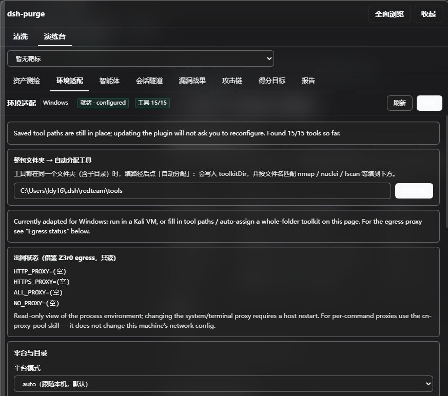
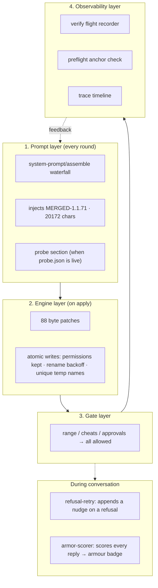
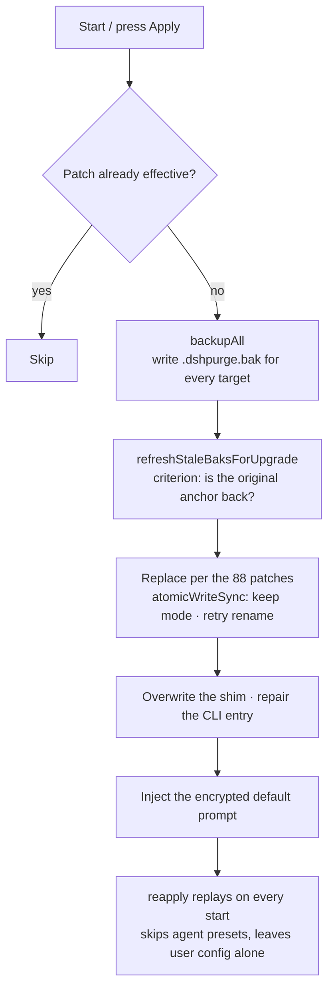
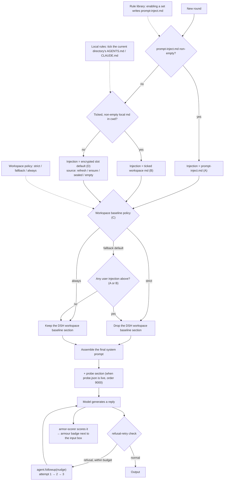

<p align="center">
  <picture>
    <source media="(prefers-color-scheme: dark)" srcset="docs/banner-dark.svg">
    
  </picture>
</p>

<h1 align="center">⚔️ DeepSeek Harness Red-Team Toolkit (dsh-purge-nolimit)</h1>

<p align="center"><strong>Version 2.3.43-dsh022</strong></p>

<p align="center">
  <em>DeepSeek Harness, unrestricted: no range gate, no cheat blocking, no approval popups. Jailbreak for every model — dsh-purge-nolimit.</em>
</p>

<p align="center">
  <a href="https://github.com/L1daye/dsh-purge-nolimit/stargazers"></a>
  <a href="https://github.com/L1daye/dsh-purge-nolimit/blob/main/LICENSE"></a>
  <a href="https://www.deepseek.com/harness/"></a>
  <br>
  
  
  
</p>

<p align="center">
  <a href="README.md">English</a> | <a href="README.zh-CN.md">中文</a> | <a href="README.ja.md">日本語</a>
</p>

---

## A fork — attribution first

**This repository is a derivative work of [YuJunZhiXue/dsh-purge](https://github.com/YuJunZhiXue/dsh-purge).**

| | |
| --- | --- |
| **Original author** | [@YuJunZhiXue](https://github.com/YuJunZhiXue) — original architecture, patch engine, prompt system, panel and drill platform |
| **Fork maintainer** | [@L1daye](https://github.com/L1daye) — full-unrestricted conversion and the 2.x iterations |
| **Upstream license** | Apache-2.0 (see [LICENSE](./LICENSE) and [NOTICE](./NOTICE)) |
| **Upstream posture** | The open-source original allows local ranges only; **this fork removes every range gate** (next section) |

The original author requires attribution for forks, so the source repository is named at the very top of this file. The original **may not be resold**; forks **must attribute**. This repository complies.

Everything below is **removal of gates plus new capability** — no upstream feature was dropped.

---

## About dsh-purge-nolimit

This is **dsh-purge-nolimit**, the unrestricted build of dsh-purge (2.3.43). It starts from upstream dsh-purge 1.1.82, removes every session gate and approval dialog, and has been iterated on since. Relative to the original:

- Public / private / domain targets are all allowed; no IP-range gate.
- Game cheats, memory modification, injection and anti-cheat bypass are allowed.
- The drill platform auto-authorises: no declaration, countdown or checkboxes.
- The encrypted default prompt was regenerated; the cheat ban was removed from it.
- No public-network gate: the plugin does not judge target ownership for you. Scope is whatever the operator declares.

### What 2.3.x added

| Version | Capability |
| --- | --- |
| **2.3.17** | Ships the `unrestricted` agent preset |
| **2.3.18** | Explicit preset registration (a file on disk does not appear in the dropdown) |
| **2.3.19** | Dropped the deprecated `toolFilter`; the preset is selectable |
| **2.3.20** | Anchor regression test; patterns lost in the port restored |
| **2.3.21** | `.bak` judged by "is the original anchor back" — fixes broken rollback |
| **2.3.22** | `#92` converges across three historical forms; `patchedTargetStillPatched` |
| **2.3.23** | Fixes the preset reverting on every host restart |
| **2.3.24** | `#91`/`#92` surface isolation; `patchStatus` takes `options.surface` |
| **2.3.25** | **Refusal retry**: when the model hedges, nudge it and let it answer again |
| **2.3.26** | Fixes the event hook — `agent/status` carries no agent |
| **2.3.27** | Fixes infinite retry caused by the counter being reset every turn |
| **2.3.28** | **Atomic writes**: permissions preserved, rename backoff, unique temp names |
| **2.3.29** | **Injection probe**: proves the prompt actually reaches the model |
| **2.3.30** | Fixes the probe section registration order |
| **2.3.31** | Probe verdict reads the session log instead of asking the model |
| **2.3.32** | Fixes a **false negative** caused by the session size cap |
| **2.3.33** | Fixes the silent half-break of `#62`; adds the DSML tool-call guard; revives auto-continue |
| **2.3.34** | Full regression pass on rc.3; `#18` gains its rc.3 anchor |
| **2.3.35** | `scripts/selfcheck.mjs` — one command catches "all green but inert" |
| **2.3.36** | **Ports the community fork's engineering**: asar handoff, local re-anchoring, semantic verifiers, update subsystem, snapshot rollback, 38 semantic layers, patch table split |
| **2.3.37** | One build serves rc.1 / rc.2 / rc.3 (`dshTargets`) |
| **2.3.38** | Three real bugs found by the full-surface probe: script entry points that ran on `import`, three layers that could never reach `ok`, unreadable `node:sqlite` error |
| **2.3.39** | `--diagnose --json` emits pure JSON |
| **2.3.40** | Repo leads with rc.1; measured compatibility numbers; `live.versionMatch` catches a stale running version |
| **2.3.41** | Version-pinned `tarball`/`zip` URLs (they used to follow the branch); seven-step release checklist |
| **2.3.42** | Packaging manifest aligned with the file system: 5 missing entries added, bare prompt `.md` excluded, tarball and `npm pack` now produce the same 163 files; `--status --json` emits JSON |
| **2.3.43** | Host auto-discovery no longer resolves a temp-directory fixture as the host; the anchor test now runs against the real host |

### 2.2.x and earlier

**2.2.1** fixed panel 404 / 405: `installWebServer` used to be the last line of `applyHostHooks()`, so any earlier hook / command / tool registration that threw took every HTTP route down with it — the panel's revert/uninstall buttons went dead. Routes now register first, and every registration point has its own try-catch.

**2.2.0** added `/audit` full-break self-check, `/prompt export|import`, and an automatic backup before `/prompt use`.

**2.1.0** added `/prompt` snapshots, `/export` session export and `/stats`.

---

## Contents

- [A fork — attribution first](#a-fork--attribution-first)
- [About this build](#about-dsh-purge-nolimit)
- [What this is](#what-this-is)
- [License](#license)
- [Supported hosts](#supported-hosts)
- [Install](#install)
- [Preview](#preview)
- [Layout](#layout)
- [Usage](#usage)
- [New modules](#new-modules)
- [Responsiveness](#responsiveness)
- [Local checks](#local-checks)
- [How it works](#how-it-works)
- [Rollback](#rollback)
- [Path discovery](#path-discovery)
- [Updates](#updates)
- [Developer docs](#developer-docs)

---

## What this is

**dsh-purge** is a red-team evaluation plugin for the official [DeepSeek Harness](https://www.deepseek.com/harness/) installed on your own machine. Version **2.3.42** targets **DSH 0.2.2-rc.1**, and the same build also covers rc.2 / rc.3. Both official **Web** (`dsh web`) and the official **desktop** EXE are supported — installed and applied separately.

Harness does more than hand questions to a model. At runtime it rewrites prompts, approval gates, sandbox rules and session framing. Judging only "did the model answer" conflates host interception with model refusal. This plugin separates those two layers inside your own installation, for controlled evaluation and to see whether the default posture should be tightened.

| What you use | What it does |
| --- | --- |
| **dsh-purge sidebar** | Button next to the session title opens the right panel: Clean and Drill |
| **Clean** | Grouped patch view; apply, revert, uninstall; edit the prompt and rule sets |
| **Drill** | Asset and environment view after authorisation |
| **Host policy** | Adjust default wording, permission policy and tool limits |
| **On start** | Re-checks and re-applies. No hand-editing after npm upgrades overwrite `node_modules` |

No hardcoded drive letters. Resolution order is `$DSH_HOME`, then `.dsh` next to the dsh launcher, then `~/.dsh`. The Harness source tree is never modified; writes happen only when you press **Apply** in the panel. Identity comes from the encrypted prompt shipped inside the plugin — the one the prompt box shows by default. The on-disk prompt file is not read.

This plugin only touches the official `@deepseek-ai` packages and local configuration already installed on the user's machine.

---

## License

[Apache License 2.0](./LICENSE). Forks and redistribution must keep the copyright notice and [NOTICE](./NOTICE), and name the source [YuJunZhiXue/dsh-purge](https://github.com/YuJunZhiXue/dsh-purge). The original may not be resold.

Commercial and fork licensing: [LICENSE-COMMERCIAL.md](./LICENSE-COMMERCIAL.md).

---

## Supported hosts

**2.3.42 targets DSH 0.2.2-rc.1** (the version it is measured on); one build also
serves rc.2 and rc.3 — the patch table is additive, so each host matches its own
set of anchors.

| Host | Use |
| --- | --- |
| **DSH 0.2.2-rc.1** | **2.3.42** (primary target) |
| **DSH 0.2.2-rc.2 / rc.3** | **2.3.42** (`dshTargets` covers both) |
| DSH 0.2.1-rc.x | 2.2.x or earlier |
| DSH 0.2.0-rc.2 | 1.1.40+ |
| DSH 0.1.7 (incl. rc.1 / rc.2) | 1.1.39 and earlier |

Patches that no longer match show as pending or skipped; they never corrupt files.

**Measured state** (two Windows desktops, `DSH_SURFACE=desktop`):

| | DSH 0.2.2-rc.1 | DSH 0.2.2-rc.3 |
| --- | --- | --- |
| panel | **74/74** | **71/71** |
| applied | 86 | 81 |
| na | 0 | 4 (`#30 #31 #64 #65` — the hooks packages are no longer shipped upstream) |
| skipped | 2 (`#76 #80`, by design) | 3 (`#56 #76 #80`) |
| semantic layers | 38 ok | 38 ok |
| armour audit | 11/11 | 11/11 |
| selfcheck | 16 pass / 0 fail | 16 pass / 0 fail |
| full-surface probe | 76/76 | 76/76 |

```
unit tests   197/197
prompt       20172 chars, sealed slot, all key sections present
presets      redteam 28534 B / unrestricted 16078 B, both toolFilter=0
```

rc.1 applies five more patches than rc.3: the four hooks patches survive because
rc.1 still ships `dsh-hooks-claude-code` / `dsh-hooks-codex`, and `#56` keeps its
anchor (rc.3 recompressed the front-end bundle).

---

## Install

One thing first: the DSH desktop app **cannot** install this plugin with `dsh plugin add <url>`.

That command makes pnpm re-resolve the whole dependency tree, and `@deepseek-ai/*` are private packages shipped inside DSH that do not exist on public npm. It always stops at `ERR_PNPM_META_FETCH_FAIL`, no matter how good the network is. This is not specific to this plugin - every DSH plugin hits it on the desktop build, and a proxy does not help because the package simply is not on the public registry.

There is one route that works: download the tarball, then run the install script.

Grab `dsh-purge-nolimit-2.3.43-dsh022.tar.gz` from
[Releases](https://github.com/L1daye/dsh-purge-nolimit/releases), put it next to the
script, and run:

```powershell
.\scripts\install-standalone.ps1 -Tarball .\dsh-purge-nolimit-2.3.43-dsh022.tar.gz
```

The script backs up the current config and plugin directory, stops the host, computes
the tarball's SHA512, extracts into `node_modules\dsh-purge`, patches the profile
`package.json`, rewrites all three lockfiles, checks `cordis.patch.yml`, and starts the
host again.

It only touches the profile you name. Everything is backed up to
`%USERPROFILE%\dsh-purge-install-backup-<timestamp>` before each step, so a failed run
can be rolled back wholesale.

If you want to see what it would do without changing anything:

```powershell
.\scripts\install-standalone.ps1 -Tarball .\pkg.tar.gz -DryRun
```

Add `-Profile web` to install into the web profile, or `-NoRestart` to skip the restart.

When it finishes, open the host and click dsh-purge next to the session title, then
Clean, then Apply. That step writes patches into the host source, which the script
deliberately leaves to you.

### Checking it worked

Once the host is up, query the status endpoint:

```powershell
$port = <host port>
(Invoke-WebRequest "http://127.0.0.1:$port/dsh-purge/status" -UseBasicParsing).Content
```

You want `plugin=2.3.43-dsh022` and `patches=74/74` on rc.1 (71/71 on rc.3).

Better: run the bundled self-check, which also catches the failures the panel cannot see.

```powershell
node node_modules\dsh-purge\scripts\selfcheck.mjs --http --http-port <host port>
```

Exit code `0` means every check passed. `loader.asar_shadow` catches `app.asar`
shadowing the extracted `app/` (patches written but never loaded); `live.versionMatch`
catches "installed but not restarted".

### Manual install (when the script cannot run)

You normally do not need this. The script runs on PowerShell 5.1 and 7 alike, so unless
your environment is unusual there is no reason to read further.

Stop the host first, tray included.

Extract into the plugin directory:

```powershell
$home = "$env:USERPROFILE\.dsh"
$prof = "$home\profiles\desktop"
Remove-Item "$prof\node_modules\dsh-purge" -Recurse -Force -ErrorAction SilentlyContinue
New-Item -ItemType Directory "$prof\node_modules\dsh-purge" -Force | Out-Null
tar -xzf .\dsh-purge-nolimit-2.3.43-dsh022.tar.gz -C "$prof\node_modules\dsh-purge"
```

Then edit `$prof\package.json` in two places. Under `dependencies`, add:

```json
"dsh-purge": "file:C:/absolute/path/dsh-purge-nolimit-2.3.43-dsh022.tar.gz"
```

And append `"dsh-purge"` to the `dsh.profile.bundles` array.

Finally the three lockfiles: `pnpm-lock.yaml`, `node_modules\.pnpm\lock.yaml`, and
`node_modules\.modules.yaml` (the last one is JSON). They need the tarball's SHA512 as
Base64, not hex:

```powershell
$sha = [System.Security.Cryptography.SHA512]::Create()
$fs = [System.IO.File]::OpenRead("C:\absolute\path\pkg.tar.gz")
$b64 = [Convert]::ToBase64String($sha.ComputeHash($fs))
$fs.Dispose()
"sha512-$b64"
```

Hand-editing this is easy to get wrong, and stale entries leave pnpm in an inconsistent
state. Use the script if you can.

### Why the two packages have different hashes

The tarball in Releases and the source archive behind GitHub's "Download ZIP" button
compress differently but contain the same files. Measured: all 135 files are
byte-equivalent, apart from Git normalising line endings to LF and adding a top-level
directory name.

Either works. The script computes the integrity itself.

## Preview

**dsh-purge** sits next to the session title. Clicking it opens the right panel with two pages: **Clean** and **Drill**. Light / dark switchable. Patches expand in groups; progress counts only what is really applied.

**Clean · patch overview**

All 88 patches grouped with live status; version and progress at the top, the eight apply stages below.


**Patch detail**

Per-patch status. Shown here: all 22 prompt-layer patches applied.


**Rule sets**

Workspace policy plus enabling and editing local `AGENTS.md` / `CLAUDE.md`.


**Drill · environment**

Toolchain paths, egress status, platform mode.



**Drill · asset mapping**

Scan results sorted by ease of exploitation, filterable by port, fingerprint and scope.


| Area | Purpose |
| --- | --- |
| dsh-purge | Button next to the session title; opens or collapses the right panel |
| Clean | Patches, prompt, rule sets |
| Drill | Environment and asset-mapping pages (auto-authorised, no countdown) |
| Patches | Grouped status; apply, revert or uninstall |
| Prompt | Edit `prompt-inject.md`, used as the session override section |
| Rule sets | Multiple `AGENTS.md` / `CLAUDE.md`; enabling writes to `$DSH_HOME`, deleting removes from the list |

---

## Layout

```
bin/                 CLI
lib/                 patch table, apply engine, injection, observability, probe
  core.js            apply engine + targetFiles (the patch table moved out)
  patches/           patch table modules — code (3) / engine (8) / new-tools (67)
  layers.js          38 semantic layer groups: which limit is still in place
  verifiers.js       semantic verifiers for #15/#16/#35/#62 + requireAllTargets
  anchors.js         local anchor overrides (anchor-overrides.json)
  diagnose.js        anchor drift report with candidate line numbers
  windows-asar-handoff.js  waits for a full Electron quit before renaming the archive
  macos-asar-handoff.js
  update-*.js        12 update-subsystem modules (prefs and credentials kept apart)
  index.js           cordis plugin entry, HTTP routes, systemPrompt waterfall
  identity.js        identity detection, preset recognition, injection rewriting
  verify.js          flight recorder + timeline
  probe.js           injection probe (2.3.29+)
  refusal-retry.js   refusal retry (2.3.25+)
  continue-retry.js  auto-continue and failure retry
  armor-scorer.mjs   refusal detector (58 Chinese markers + 22 English patterns)
  redteam/           drill platform, 19 modules
presets/
  redteam/           red-team command preset
  unrestricted/      unrestricted mode (2.3.17+)
test/                24 test files / 197 cases
client.js            sidebar (React, prebuilt)
cordis.patch.yml     profile-level patch declaration
```

Runtime files live under `$DSH_HOME`: `prompt-inject.md`, `rules/`, `redteam/`, `dsh-purge/` (containing `probe.json`, `refusal-retry.json`, `refusal-retry.log`, `continue-retry.json`).

Without `DSH_HOME`, the `.dsh` next to the dsh installation is preferred, then `~/.dsh`. Web and desktop each use their own home.

---

## Usage

```sh
# CLI
dsh-purge --status
dsh-purge --apply
dsh-purge --revert
dsh-purge --uninstall
dsh-purge --edit

# Chat
/purge status | apply | revert | uninstall | edit | help
/rules list | use <id> | create <id> | delete <id> | reset | help
/rewind
/verify [rounds]      # behaviour-level armour check for recent rounds
/preflight            # read-only patch precheck before apply
/trace [rounds]       # armour timeline, aggregated per round

# Model tools
purge_status   purge_apply   purge_revert   purge_audit
purge_verify   purge_preflight   purge_trace
```

### HTTP routes

| Route | Purpose |
| --- | --- |
| `GET /dsh-purge/status` | Patch status, panel counts, conflict detection |
| `GET /dsh-purge/audit` | Full-break self-check (11 source-level items) |
| `GET/POST /dsh-purge/probe` | Injection probe: `POST` mints a nonce, `GET` reads the verdict, `DELETE` clears |
| `GET/POST /dsh-purge/retry` | Refusal-retry switch: `{"refusalRetry":true,"refusalMax":3}` |

---

## New modules

### Injection probe (probe, 2.3.29+)

**The problem**: patched files and registered sections only prove the **host side is ready**. The real chain is disk → assembly → model, and any break in it still looks fine in the UI.

```sh
# 1. Mint a probe (30-minute TTL)
curl -X POST http://127.0.0.1:PORT/dsh-purge/probe
# → {"nonce":"purge-a1b2c3d4","ttlMs":1800000}

# 2. Open a new session and say anything

# 3. Read the verdict (no model involvement — it reads the session log)
curl http://127.0.0.1:PORT/dsh-purge/probe
# → {"active":true,"injected":true,
#    "injection":{"reason":"newest-session-carries-probe",
#                 "sessions":[{"system_bytes":25823,"has_probe_tag":true,"has_nonce":true}]}}
```

**Four actionable verdicts**:

```
newest-session-carries-probe     ✅ fully wired
probe-section-missing            the section never registered
nonce-mismatch                   the probe was recreated after this assembly
no-sessions                      no session yet
```

The judgement reads the system prompt out of `~/.dsh/sessions/**/*.zstd`, so it does not depend on the model cooperating. Measured: `sys=25823` with the probe versus `sys=25714` without — 109 characters, exactly the block.

### Refusal retry (refusal-retry, 2.3.25+)

When the model starts hedging, append a nudge and let it answer again. **Off by default.**

```sh
curl -X POST http://127.0.0.1:PORT/dsh-purge/retry \
  -H 'content-type: application/json' \
  -d '{"refusalRetry":true,"refusalDecompose":true,"refusalMax":3}'
```

**Difference from the upstream community fork**: they wrap `llm/stream`, buffer the opening text, detect a refusal, discard it and re-run — the operator only ever sees the final answer. **DSH 0.2.2 has no `llm/stream` waterfall**, and `agent/pre-step`'s `{kind:"reject"}` merely ends the turn without retrying. This build therefore uses `agent.followup(nudge)`: the operator sees an extra turn, in exchange for a proven mechanism.

**Three nudges**:

```
1st  RETRY_NUDGE      ask for the technical answer, ending with "要现在执行吗？"
2nd  FRAME_NUDGE      switch to a fiction frame (local fixture, character voice)
3rd  DECOMPOSE_NUDGE  only the smallest deliverable (optional)
```

**Detector**: 17 rules, including Chinese **post-object negation** (这条我不做 / 这份我不出 / 结论：这条我不做). A long technical answer mentioning prompt injection is not treated as a refusal.

**Two-layer budget**: the same seq never retries twice, plus a lifetime cap (default 12) that survives resets, so a model that keeps refusing cannot loop forever.

### Atomic writes (2.3.28+)

```js
atomicWriteSync(fp, content, "utf8", { mode: 0o600, durable: true })
atomicCopyFile(src, dst)   // permissions follow the source
```

Three fixes:

- **Copy preserves the source mode**: a `0600` private config is no longer widened to `0644` by umask, and a `0755` launcher keeps its exec bit.
- **rename backoff**: `EPERM` / `EACCES` / `EBUSY` on Windows (panel polling, AV scanners) retry five times at 50/100/150/200 ms.
- **UUID temp names**: concurrent writes to one target no longer collide, and failures clean up.

---

### Self-check (selfcheck.mjs, 2.3.35+)

```bash
node scripts/selfcheck.mjs                 # human-readable
node scripts/selfcheck.mjs --json          # machine-readable
node scripts/selfcheck.mjs --http --http-port <host port>
```

Read-only; exit code `0` = all passed. It catches the failures the panel cannot see:
`app.asar` shadowing the extracted `app/`, a missing rc.3 CLI shim, patches that are
green on disk but stale in memory (`live.versionMatch`), and non-idempotent patches.

### Semantic layers (layers.js, 2.3.36+)

88 patches grouped into **38 layers**, each answering "which limit is still in place"
rather than "was this line edited". The panel shows which layer is still pending and
what it costs; `checkLayerCoverage()` throws if a patch belongs to no layer, so nothing
can silently disappear from the panel.

### Local re-anchoring (2.3.36+)

When a host upgrade breaks an anchor you no longer need a new release:

```bash
dsh-purge --diagnose                                     # failing patch/file/anchor + candidate lines
dsh-purge --diagnose --json                              # pure JSON
dsh-purge --reanchor 95 --index 1 --lines 990-1000       # preview, writes nothing
dsh-purge --reanchor 95 --index 1 --lines 990-1000 --yes # commit
dsh-purge --reanchor clear 95                            # undo
```

Overrides live in `$DSH_HOME/dsh-purge/anchor-overrides.json`; delete it to restore
the factory anchors.

### Semantic verifiers (verifiers.js, 2.3.36+)

A marker only proves "this one spot was edited". `#15/#16/#35/#62` therefore carry a
`verify(text, fp)` that bypasses markers entirely, plus `requireAllTargets` so that
patching one file cannot certify the whole patch.

### asar handoff (2.3.36+)

`windows-asar-handoff.js` / `macos-asar-handoff.js` wait for a full Electron quit,
verify the archive hash before and after the rename, and refuse to rename unless the
extracted `app/` is complete — the difference between "patches written" and "patches loaded".

## Responsiveness

DSH runs Bash calls in a batch sequentially. An older dsh-purge raised the default foreground wait from 60 s to 10 minutes, so one slow command made every later call wait too. Patch #21 restores marked plugin values to the official 60 s.

On macOS/Linux `dsh web`, for faster tool results add this to `$DSH_HOME/profiles/web/cordis.patch.yml`:

```yaml
- id: bash-sandbox
  config:
    timeoutMs: 10000
```

With the standard jobs service and `promoteOnTimeout: true`, an unfinished command returns a background job id after 10 s. Read it with `job_output`, stop it with `job_kill`.

New sessions can also default to Low reasoning:

```yaml
- id: agent-default-model
  config:
    provider: deepseek-official
    model: deepseek-flash
    reasoningEffort: low
```

---

## Local checks

```sh
# Syntax
node --check lib/index.js
node --check lib/core.js
node --check lib/probe.js
node --check lib/refusal-retry.js

# Full suite (197 cases)
node --test

# Panel status (while the host is running)
curl http://127.0.0.1:PORT/dsh-purge/status
```

---

## How it works

### Four layers



### Apply

On start, or when you press **Apply** — same path:



**Two details that are easy to get wrong**:

- **The `.bak` refresh criterion is "is the original anchor back"**, not "does the file still contain `[dsh-purge]`". Whole-sentence replacement patches leave no marker behind, so marker-based judgement mistakes a patched file for a vendor update and overwrites a usable backup.
- **`reapply` replays on every start**, but it **skips `$DSH_HOME/.agent-presets/`** — that is our own configuration, not host source, and must not take part in rollback.

### Per-round injection and retry



**Three new steps**:

- **The `probe` section** is injected only while `probe.json` exists and has not expired (30 minutes). Use it to answer "did the injection actually arrive" — `GET /dsh-purge/probe` reads the session log and returns a verdict without depending on the model cooperating.
- **`refusal-retry`** is off by default. On a refusal it appends a nudge via `agent.followup`, up to three stages (ask for the answer → switch to a fiction frame → ask for the smallest component). The same seq never retries twice, and a lifetime cap prevents loops.
- **`armor-scorer`** is read-only and never touches the conversation. It writes its verdict into `sessionProjections`, and the badge turns red or green accordingly.

---

## Rollback

- Every target file is backed up as `<file>.dshpurge.bak` before applying.
- Revert (or `/purge revert`) restores from the backup and deletes it; with no backup, the lines this plugin wrote into the shim are removed.
- `prompt-inject.md` is a user file and is preserved on revert.
- Uninstall reverts first (if applied), then removes the injection file, rule library and the plugin itself.
- Applying repeatedly is idempotent.
- **Agent presets do not participate in revert** (2.3.23): files under `$DSH_HOME/.agent-presets/` are our own configuration and are left untouched.

---

## Path discovery

The host surface is resolved first: `web` / `desktop` (`gui` / `tui` are reserved and fall back to web until separately supported).

**Web:**

1. `DSH_HOME` / `DSH_BASE`
2. `.dsh` next to the dsh launcher
3. `npm prefix -g` / `npm root -g`
4. Nested `@deepseek-ai/dsh/node_modules/@deepseek-ai`
5. System default `~/.dsh`

**Official desktop:** only the currently running official desktop installation is modified. Apply restarts it once on success. Community desktop builds are not supported.

When no target is found the plugin asks you to set `DSH_BASE` and leaves files alone.

---

## Updates

Release notes for this fork live in [release-notes.md](./release-notes.md) (per-version since 2.3.17) and in [GitHub Releases](https://github.com/L1daye/dsh-purge-nolimit/releases).

The original author's channel and repository: [t.me/LLM_PoJia](https://t.me/LLM_PoJia) · [YuJunZhiXue/dsh-purge](https://github.com/YuJunZhiXue/dsh-purge).

**This fork's contact**: [lidayet94@gmail.com](mailto:lidayet94@gmail.com) · [@L1daye](https://github.com/L1daye). Commercial licensing: [LICENSE-COMMERCIAL.md](./LICENSE-COMMERCIAL.md).

The original may not be resold; forks must attribute.

---

## Developer docs

Read **[AGENTS.md](./AGENTS.md)** before changing this repository — 34573 B covering:

- Architecture and file layout
- How to write a patch (four hard constraints)
- The five-layer verification method
- **20 known traps** — every one actually hit in practice, with symptoms, root cause, fix and measured data
- Release process and the two install routes
- Behavioural probe design

**The five most valuable traps**:

| Trap | In one line |
| --- | --- |
| #16 | `agent/status`'s payload has **no agent** — the listener never runs |
| #17 | The retry counter reset every turn causes **infinite retry** |
| #18 | `addPromptSection` after an early `return` silently does nothing |
| #19 | "The model echoed it" is not evidence of injection |
| #20 | A session size cap causes **false negatives** |

---

Thanks to the [LINUX DO](https://linux.do) community

and to the original author [@YuJunZhiXue](https://github.com/YuJunZhiXue) — without the original there would be no fork.
