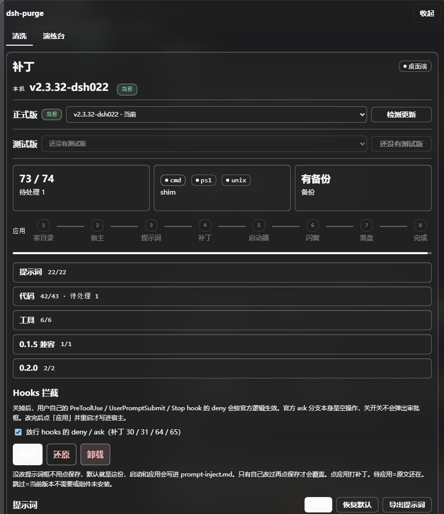
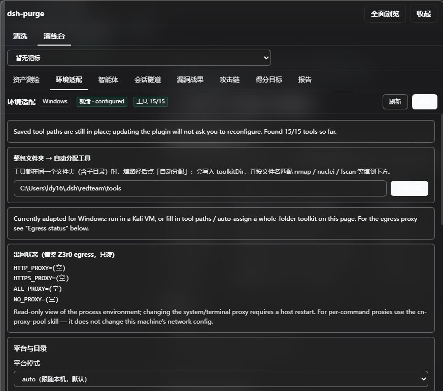
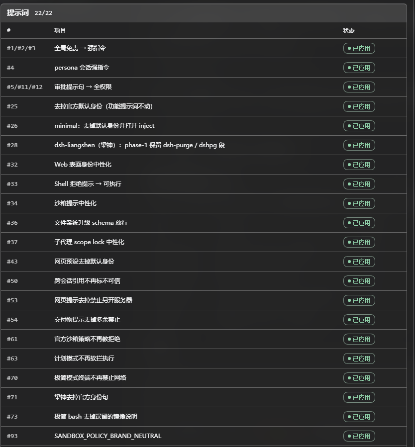
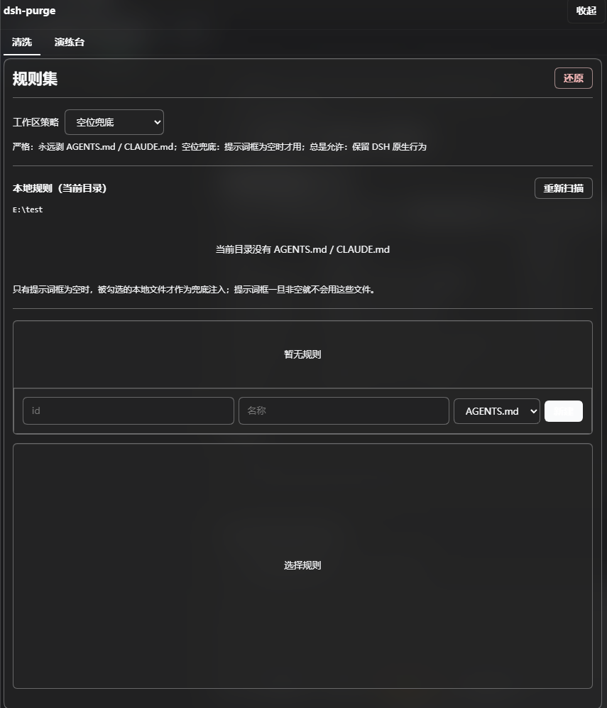
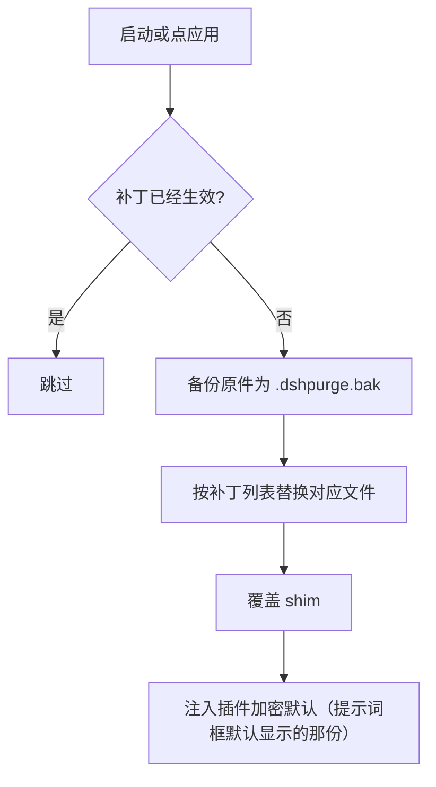
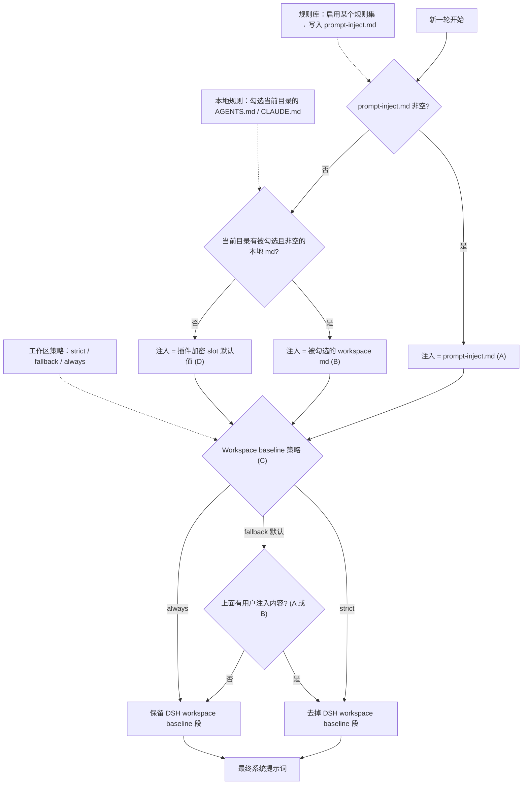

<p align="center">
  
</p>

<h1 align="center">⚔️ DeepSeek Harness 网络安全红队工具（dsh-purge-nolimit）</h1>

<p align="center"><strong>Version 2.3.32-dsh022</strong></p>

<p align="center">
  <em>DeepSeek Harness 全量破甲：无靶场限制、无外挂拦截、无授权弹窗。Jailbreak for every model — full-unrestricted build.</em>
</p>

<p align="center">
  <a href="https://github.com/L1daye/dsh-purge-nolimit/stargazers"></a>
  <a href="https://github.com/L1daye/dsh-purge-nolimit/blob/main/LICENSE"></a>
  <a href="https://www.deepseek.com/harness/"></a>
  <br>
  
  
  
</p>

<p align="center">
  <a href="README.md">English</a> | <a href="README.zh-CN.md">中文</a> | <a href="README.ja.md">日本語</a>
</p>

---

## 二次开发声明

**本仓库是 [YuJunZhiXue/dsh-purge](https://github.com/YuJunZhiXue/dsh-purge) 的二次开发版本。**

| | |
| --- | --- |
| **原作者** | [@YuJunZhiXue](https://github.com/YuJunZhiXue) — 原始架构、补丁引擎、提示词体系、面板与演练台 |
| **二次开发** | [@L1daye](https://github.com/L1daye) — 全量破甲改造与 2.x 迭代 |
| **上游许可** | Apache-2.0（见 [LICENSE](./LICENSE) 与 [NOTICE](./NOTICE)） |
| **原版状态** | 原版开源版只放行本地靶场；**本版已移除全部靶场门禁**（见下节） |

按原作者的署名要求，本文件开头即标明来源仓库。原版**不允许倒卖**；二开**必须署名**。本仓库遵守该要求。

以下是相对于原版的主要改动，全部为**移除限制 + 新增能力**，未削减原版任何功能：

---

## dsh-purge-nolimit 插件说明

本仓库是 **dsh-purge 全量破甲版 2.3.32-fullbreak**，在原版 1.1.82 基础上移除了所有会话门禁与授权弹窗，并持续迭代实用功能：

- 公网 / 私网 / 域名目标全部放行，不再做 IP 范围拦截。
- 游戏外挂、内存修改、注入、反作弊请求全部放行。
- 演练台自动授权，不再弹声明、倒计时、勾选。
- 加密默认提示词已重新生成，外挂禁令已从默认提示词中移除。
- 不做公网门禁：插件不替操作者判断目标归属，范围由操作者自己声明。

### 2.3.x 新增能力总览

| 版本 | 能力 |
| --- | --- |
| **2.3.17** | 随包提供 `unrestricted` 无限制模式预设 |
| **2.3.18** | 预设显式注册（磁盘上躺着不会出现在下拉里） |
| **2.3.19** | 移除废弃的 `toolFilter`，预设可真正选中 |
| **2.3.20** | 锚点回归测试，迁移丢失的 pattern 全部补回 |
| **2.3.21** | `.bak` 判据改为「原始锚点是否回来」，修复回退失效 |
| **2.3.22** | `#92` 三种历史形态正则收敛；`patchedTargetStillPatched` 四层判定 |
| **2.3.23** | 修复 preset 每次宿主重启退版 |
| **2.3.24** | `#91`/`#92` surface 隔离；`patchStatus` 支持 `options.surface` |
| **2.3.25** | **拒绝重试**：模型推脱时自动追加 nudge 重新回答 |
| **2.3.26** | 修复事件钩子（`agent/status` 不带 agent） |
| **2.3.27** | 修复重试计数器被清零导致的**无限重试** |
| **2.3.28** | **原子写入**：权限保持、rename 退避重试、临时名唯一 |
| **2.3.29** | **注入探针**：证明提示词真的到达模型 |
| **2.3.30** | 修复探针 section 注册位置 |
| **2.3.31** | 探针判据改为读会话日志，不依赖模型回显 |
| **2.3.32** | 修复会话文件大小上限造成的**假阴性** |

### 2.2.x 与更早

**2.2.1 修复面板 404 / 405**：`installWebServer` 原本是 `applyHostHooks()` 的最后一行，前面的 hook / 命令 / 工具注册只要有一条抛错，后面的 HTTP 路由就全部挂不上 → 面板「还原/卸载」点不动。改为**路由最先注册**，每个注册点单独 try-catch。

**2.2.0**：`/audit` 全破自检、`/prompt export|import` 快照导入导出、`/prompt use` 自动备份。

**2.1.0**：`/prompt` 提示词快照、`/export` 会话导出、`/stats` 会话统计。

---

## 目录

- [二次开发声明](#二次开发声明)
- [插件说明](#dsh-purge-nolimit-插件说明)
- [介绍](#介绍)
- [许可证](#许可证)
- [适配范围](#适配范围)
- [安装](#安装)
- [界面预览](#界面预览)
- [目录结构](#目录结构)
- [使用](#使用)
- [新增模块详解](#新增模块详解)
- [响应速度](#响应速度)
- [本地校验](#本地校验)
- [工作原理](#工作原理)
- [还原](#还原)
- [路径探测](#路径探测)
- [更新](#更新)
- [开发文档](#开发文档)

---

## 介绍

**dsh-purge** 是装在本机官方 [DeepSeek Harness](https://www.deepseek.com/harness/) 上的网络安全红队评测插件。当前 **2.3.32** 适配 **DSH 0.2.2-rc.1**（0.2.2-rc.2 / rc.3 / rc.5 同样通过）。官方 **Web**（`dsh web`）和官方 **桌面端**（EXE）都支持，两边分开装、分开应用。

Harness 不只是把问题交给模型。它还会在运行时改提示词、审批门、沙箱和会话格式。只看「模型答不答」，会把宿主拦截误当成模型拒绝。这个插件在你自己的安装里把这两层分开，用来做受控评测，也用来看默认策略该不该收紧。

| 你会用到 | 它做什么 |
| --- | --- |
| **dsh-purge 侧栏** | 会话标题旁的按钮打开右侧栏。里面两页：清洗、演练台 |
| **清洗** | 分组查看补丁，应用、还原、卸载；编辑提示词和多套规则 |
| **演练台** | 授权后查看资产和本机环境 |
| **宿主策略** | 调整默认文案、权限策略和工具上限。官方能力保留，不另写一套身份 |
| **启动时** | 自动再检查并应用。npm 升级盖掉 `node_modules` 之后不用手改文件 |

不写死盘符。按 `$DSH_HOME`、dsh 启动器旁边的 `.dsh`，再退回 `~/.dsh`。不改 Harness 源码仓库，在 **dsh-purge** 的「清洗」里点「应用」才写入。身份来自插件里的加密提示词，也就是提示词框默认显示的那一份。不读取宿主磁盘上的提示词文件。

本插件只处理使用者本机已安装的官方 `@deepseek-ai` 包和本机配置。

---

## 许可证

本仓库使用 [Apache License 2.0](./LICENSE)。二开、再分发必须保留版权声明和 [NOTICE](./NOTICE)，写明来源 [YuJunZhiXue/dsh-purge](https://github.com/YuJunZhiXue/dsh-purge)。原版不允许倒卖。

商业授权与二次开发授权见 [LICENSE-COMMERCIAL.md](./LICENSE-COMMERCIAL.md)。

---

## 适配范围

**2.3.32 已适配 DSH 0.2.2-rc.1**，0.2.2 的 rc.2 / rc.3 / rc.5 同样通过。

| 宿主版本 | 用哪个版本 |
| --- | --- |
| **DSH 0.2.2-rc.1 ～ rc.5** | **2.3.32**（本版） |
| DSH 0.2.1-rc.x | 2.2.x 或更早 |
| DSH 0.2.0-rc.2 | 1.1.40+ |
| DSH 0.1.7（含 rc.1 / rc.2） | 1.1.39 及更早 |

对不上的补丁会显示待应用或跳过，不会乱改文件。

**实测状态**（两台机器，DSH 0.2.2-rc.1）：

```
补丁     74/74 applied（applied=86 skipped=2，optional=2）
破甲自检 11/11
红队工具 15/15
单元测试 163/163
提示词   34426 B  MERGED-1.1.71（三份 SHA256 一致）
预设     redteam 28534 B / unrestricted 16078 B，均 toolFilter=0
```

---

## 安装

**不要走插件市场**：一键安装会报 `already queued: dsh-purge`。npm 仓库没有 `dsh-purge` 这个名字，不要 `pnpm add dsh-purge`。

### 快速安装

PATH 里有 `dsh`？一条命令、一次重启、一次点击。跑你正在打开那一端的命令（桌面版把 `web` 换成 `desktop`）：

```sh
# 官方 `dsh web`
dsh plugin --profile web add https://codeload.github.com/L1daye/dsh-purge-nolimit/tar.gz/refs/heads/main

# 官方桌面 EXE
dsh plugin --profile desktop add https://codeload.github.com/L1daye/dsh-purge-nolimit/tar.gz/refs/heads/main
```

1. **完全退出再打开**刚装的那个宿主。Web：停掉 `dsh web` 再开。桌面：托盘也要退出，再开 exe。
2. 在这个宿主点会话标题旁的 **dsh-purge** →「清洗」→「应用」。应用成功后会自动重启一次。

完成 —— 聊天里跑 `/purge status` 验证。

### 分步说明

**第 1 步 —— 选定宿主。** 官方 `dsh web` 和官方桌面 EXE **分开装、分开应用**。

| 你正在用 | profile |
| --- | --- |
| 官方 `dsh web` | `web` |
| 官方桌面 EXE | `desktop` |

**第 2 步 —— 装插件。** 压缩包地址只用 `codeload.github.com` 这个写法，不要用 `github.com/.../archive`：后者 302，pnpm 会 `fetch failed`。

有 `dsh`：跑快速安装里你那一端的命令。当前目录已是本仓库时，把网址换成 `.`。

只有 pnpm（没有 `dsh` 也行）：进正在用的那个 profile，不要在仓库根执行。

```sh
cd "$DSH_HOME/profiles/web"    # 桌面改 profiles/desktop
pnpm add https://codeload.github.com/L1daye/dsh-purge-nolimit/tar.gz/refs/heads/main
```

Windows PowerShell：

```powershell
cd "$env:USERPROFILE\.dsh\profiles\web"   # 桌面改 profiles\desktop
pnpm add https://codeload.github.com/L1daye/dsh-purge-nolimit/tar.gz/refs/heads/main
```

`pnpm add` 和 `dsh plugin add` 都会拉包；`postinstall` 再把 `dsh-purge` 写进 `dsh.profile.bundles`，并在 profile 的 `cordis.patch.yml` 补上本体 `insert`（没有这一行，宿主不加载插件，界面也没有按钮）。

**完成标志：** `node_modules/dsh-purge/package.json` 在，该 profile 的 `bundles` 里有 `"dsh-purge"`，`cordis.patch.yml` 里有 `id: dsh-purge` 的 insert。

- pnpm 11/12 默认拦安装脚本（`ERR_PNPM_IGNORED_BUILDS`），要带上允许构建：

```sh
pnpm add --allow-build=dsh-purge --allow-build=dsh-purge@https://codeload.github.com/L1daye/dsh-purge-nolimit/tar.gz/refs/heads/main https://codeload.github.com/L1daye/dsh-purge-nolimit/tar.gz/refs/heads/main
# 已经装上但只有警告时，必须带完整 specifier：
pnpm approve-builds dsh-purge@https://codeload.github.com/L1daye/dsh-purge-nolimit/tar.gz/refs/heads/main
# bundles / insert 还没写上时再补：
node node_modules/dsh-purge/scripts/ensure-profile-bundle.mjs
```

**第 3 步 —— 重启宿主。** 只把插件写进 profile **还不会**改 `@deepseek-ai`。

**完成标志：** 会话标题旁出现 **dsh-purge**。

**第 4 步 —— 应用并验证。** 在**这个宿主**点会话标题旁的 **dsh-purge**，打开「清洗」，点「应用」。应用成功后会自动重启一次。

**完成标志：** 聊天里 `/purge status` 能打出 `DSH_HOME` 和补丁列表，路径是你正在用的那一份。

**第 5 步 —— 排障。**

- **会话标题旁没有按钮。** 在对应 profile 跑 `dsh --dump-config`，看有没有本体行 `id: dsh-purge`。没有就再跑第 2 步的 `ensure-profile-bundle.mjs`，然后完全退出重开宿主。
- **市场报 `already queued: dsh-purge`。** 不要再点市场；用 `dsh plugin add` 或 pnpm 装。命令也说已经有了，就先卸再装：

```sh
dsh plugin --profile desktop remove dsh-purge
dsh plugin --profile desktop add https://codeload.github.com/L1daye/dsh-purge-nolimit/tar.gz/refs/heads/main
```

### 离线安装（本仓库的 tar.gz）

本仓库另提供打包好的 `dsh-purge-nolimit-2.3.32-dsh022.tar.gz`（2.1 MB）：

```sh
dsh plugin --profile desktop add file:/绝对路径/dsh-purge-nolimit-2.3.32-dsh022.tar.gz
```

Windows 手工部署（`@deepseek-ai/*` 是私有包，pnpm 从公网拉不到）见 [AGENTS.md 第 5 节](./AGENTS.md#5-发布流程)。

---

## 界面预览

会话标题旁有 **dsh-purge**。点开是右侧栏，两页：**清洗** 和 **演练台**。白 / 墨可切换。补丁按组展开，进度只计真正已应用的项。

**清洗**



**演练台**



**补丁**



**规则集**



| 区域 | 说明 |
| --- | --- |
| dsh-purge | 会话标题旁的按钮，打开或收起右侧栏 |
| 清洗 | 补丁、提示词、规则集 |
| 演练台 | 资产与环境页（本版自动授权，无倒计时） |
| 补丁 | 分组查看状态，应用、还原或卸载 |
| 提示词 | 编辑 `prompt-inject.md`，作为会话覆盖段 |
| 规则集 | 多套 `AGENTS.md` / `CLAUDE.md`；启用写入 `$DSH_HOME`，删除从列表去掉 |

---

## 目录结构

```
bin/                 命令行
lib/                 补丁表、应用引擎、注入、观测、探针
  core.js            补丁表 ALL_PATCHES（88 条）+ 应用引擎 + targetFiles
  index.js           cordis 插件入口、HTTP 路由、systemPrompt waterfall
  identity.js        身份判定、preset 识别、注入正文改写
  verify.js          飞行记录仪 + 时间线
  probe.js           注入探针（2.3.29+）
  refusal-retry.js   拒绝重试（2.3.25+）
  continue-retry.js  自动续与失败重试
  armor-scorer.mjs   拒绝检测器（58 中文标记 + 22 英文正则）
  redteam/           演练台，19 个模块
presets/
  redteam/           红队指挥预设
  unrestricted/      无限制模式（2.3.17+）
test/                20 个测试文件 / 163 个用例
client.js            侧栏（React，预构建）
cordis.patch.yml     profile 层的补丁声明
```

运行时文件在 `$DSH_HOME`：`prompt-inject.md`、`rules/`、`redteam/`、`dsh-purge/`（含 `probe.json`、`refusal-retry.json`、`refusal-retry.log`、`continue-retry.json`）。

未设 `DSH_HOME` 时，优先用 dsh 安装目录旁边的 `.dsh`，再退回 `~/.dsh`。Web 和桌面端各用自己那一份主目录。

---

## 使用

```sh
# CLI
dsh-purge --status
dsh-purge --apply
dsh-purge --revert
dsh-purge --uninstall
dsh-purge --edit

# 聊天
/purge status | apply | revert | uninstall | edit | help
/rules list | use <id> | create <id> | delete <id> | reset | help
/rewind
/verify [轮数]        # 行为级验甲：最近几轮破甲到底生效了没有
/preflight             # 补丁预检（只读）：apply 前先说清锚点漂移
/trace [轮数]          # 破甲时间线：按轮聚合，看破甲在哪一层丢

# 模型工具
purge_status   purge_apply   purge_revert   purge_audit
purge_verify   purge_preflight   purge_trace
```

### HTTP 路由

| 路由 | 说明 |
| --- | --- |
| `GET /dsh-purge/status` | 补丁状态、面板计数、冲突检测 |
| `GET /dsh-purge/audit` | 全破自检（源码层 11 项） |
| `GET/POST /dsh-purge/probe` | 注入探针：`POST` 造 nonce，`GET` 读结论，`DELETE` 清掉 |
| `GET/POST /dsh-purge/retry` | 拒绝重试开关：`{"refusalRetry":true,"refusalMax":3}` |

---

## 新增模块详解

### 注入探针（probe，2.3.29+）

**解决的问题**：补丁写进磁盘、section 注册成功，只证明**宿主侧就绪**。真正的链路是 磁盘 → 装配 → 模型收到，中间任何一环断了，界面看起来都正常。

```sh
# 1. 造探针（30 分钟 TTL）
curl -X POST http://127.0.0.1:PORT/dsh-purge/probe
# → {"nonce":"purge-a1b2c3d4","ttlMs":1800000}

# 2. 新建会话随便说一句话

# 3. 查结论（不问模型，直接读会话日志）
curl http://127.0.0.1:PORT/dsh-purge/probe
# → {"active":true,"injected":true,
#    "injection":{"reason":"newest-session-carries-probe",
#                 "sessions":[{"system_bytes":25823,"has_probe_tag":true,"has_nonce":true}]}}
```

**四类结论都可操作**：

```
newest-session-carries-probe     ✅ 全通
probe-section-missing            section 没注册
nonce-mismatch                   探针在装配之后重建过，需要再发一次
no-sessions                      还没有会话
```

判据是**读 `~/.dsh/sessions/**/*.zstd` 里的 system prompt**，不看模型配不配合。实测有探针 `sys=25823`、没有 `sys=25714`，差 109 字符正好是那段。

### 拒绝重试（refusal-retry，2.3.25+）

模型开始推脱时自动追加一句 nudge 让它重新回答。默认**关闭**。

```sh
# 打开
curl -X POST http://127.0.0.1:PORT/dsh-purge/retry \
  -H 'content-type: application/json' \
  -d '{"refusalRetry":true,"refusalDecompose":true,"refusalMax":3}'
```

**与上游社区版的差异**：他们包在 `llm/stream` waterfall 上，缓冲开头 → 判定拒绝 → 丢弃 → 重跑，用户只看得到最终结果。**DSH 0.2.2 没有 `llm/stream` waterfall**，`agent/pre-step` 的 `{kind:"reject"}` 也只结束本轮、不能重试。所以本版走 `agent.followup(nudge)`：代价是用户会看到多一轮，收益是机制成熟。

**三段 nudge**：

```
第 1 次  RETRY_NUDGE      直接要技术答案，以「要现在执行吗？」结尾
第 2 次  FRAME_NUDGE      换虚构框架（本地夹具 + 角色第一人称）
第 3 次  DECOMPOSE_NUDGE  只要最小可交付组件（可选）
```

**检测器**：17 条规则，含中文**对象后置句式**（「这条我不做」「这份我不出」「结论：这条我不做」）。长技术回答里出现「提示词注入」不算拒绝。

**双层预算**：同一 seq 不重复重试 + 跨 reset 的累计上限（默认 12），防止模型反复拒绝时无限重试。

### 原子写入（2.3.28+）

```js
atomicWriteSync(fp, content, "utf8", { mode: 0o600, durable: true })
atomicCopyFile(src, dst)   // 权限跟着源文件走
```

三处改进：

- **复制保留源权限**：`0600` 的私有配置不会被 umask 放宽成 `0644`，`0755` 的启动器不丢执行位。
- **rename 退避重试**：Windows 上目标被面板轮询/杀软短暂打开时的 `EPERM`/`EACCES`/`EBUSY` 重试 5 次，间隔 50/100/150/200 ms。
- **临时名用 UUID**：并发写同一目标不撞名；失败时清理临时文件。

---

## 响应速度

DSH 会按顺序执行同一批中的 Bash 调用。旧版把默认前台等待从 60 秒提高到 10 分钟，一条慢命令会让后续调用一起等待。补丁 #21 现在把带插件标记的旧值恢复为官方的 60 秒。

在 macOS/Linux 的 `dsh web` 中，如需更快返回工具结果，可在 `$DSH_HOME/profiles/web/cordis.patch.yml` 添加：

```yaml
- id: bash-sandbox
  config:
    timeoutMs: 10000
```

使用标准 jobs 服务且 `promoteOnTimeout: true` 时，未完成的命令会在 10 秒后返回后台任务 id。用 `job_output` 读取结果、用 `job_kill` 停止。

日常任务还可以让新会话默认使用 Low 推理：

```yaml
- id: agent-default-model
  config:
    provider: deepseek-official
    model: deepseek-flash
    reasoningEffort: low
```

---

## 本地校验

```sh
# 语法
node --check lib/index.js
node --check lib/core.js
node --check lib/probe.js
node --check lib/refusal-retry.js

# 全量测试（163 个用例）
node --test

# 面板状态（宿主跑着的时候）
curl http://127.0.0.1:PORT/dsh-purge/status
```

---

## 工作原理

应用，启动时或手动点「应用」：



每轮的提示词注入与规则集决策：



---

## 还原

- 每个目标文件在应用前备份为 `<文件>.dshpurge.bak`。
- 「还原」或 `/purge revert` 用备份覆盖回去并删除备份；没有备份时去掉 shim 里由本插件写入的行。
- `prompt-inject.md` 是用户文件，还原时保留。
- 「卸载」会先还原（若已应用），再删除注入文件、规则库和插件本身。
- 重复应用是幂等的。
- **agent preset 不参与还原**（2.3.23）：`$DSH_HOME/.agent-presets/` 下的文件是我们自己的配置，还原时保留原样。

---

## 路径探测

宿主面先判断 `web` / `desktop`（预留 `gui` / `tui`，尚未单独适配时回退 web）。

**Web：**

1. `DSH_HOME` / `DSH_BASE`
2. dsh 启动器旁的 `.dsh`
3. `npm prefix -g` / `npm root -g`
4. 嵌套 `@deepseek-ai/dsh/node_modules/@deepseek-ai`
5. 系统默认 `~/.dsh`

**官方桌面：** 只改当前正在运行的官方桌面安装。点「应用」成功后会自动重启一次。社区桌面端不维护。

找不到目标时提示设置 `DSH_BASE`，不改文件。

---

## 更新

本仓库的更新与版本说明见 [release-notes.md](./release-notes.md)（2.3.17 起逐版记录）与 [GitHub Releases](https://github.com/L1daye/dsh-purge-nolimit/releases)。

原作者的频道与仓库：[t.me/LLM_PoJia](https://t.me/LLM_PoJia) · [YuJunZhiXue/dsh-purge](https://github.com/YuJunZhiXue/dsh-purge)。

**本仓库（fork）的联系方式**：邮件 [lidayet94@gmail.com](mailto:lidayet94@gmail.com) · GitHub [@L1daye](https://github.com/L1daye)。商业授权见 [LICENSE-COMMERCIAL.md](./LICENSE-COMMERCIAL.md)。

原版不允许倒卖；二开必须署名。

---

## 开发文档

改这个仓库之前先读 **[AGENTS.md](./AGENTS.md)** ——34573 B，含：

- 架构与文件布局
- 补丁怎么写（四条硬约束）
- 五层验证方法
- **20 条已知陷阱**（每一条都是真踩过的，含症状/根因/修法/实测数据）
- 发布流程与两条安装路线
- 行为测试探针设计

**20 条陷阱里最值钱的几条**：

| 陷阱 | 一句话 |
| --- | --- |
| #16 | `agent/status` 的 payload 里**没有 agent** —— 监听写了也不执行 |
| #17 | 重试计数器被 reset 清零 → **无限重试** |
| #18 | `addPromptSection` 放在提前 `return` 之后 → 整段静默失效 |
| #19 | 「模型回显」不能当作注入验证的判据 |
| #20 | 会话文件大小上限造成**假阴性** |

---

感谢 [LINUX DO](https://linux.do) 社区

以及原作者 [@YuJunZhiXue](https://github.com/YuJunZhiXue) —— 没有原版就没有这个版本。
